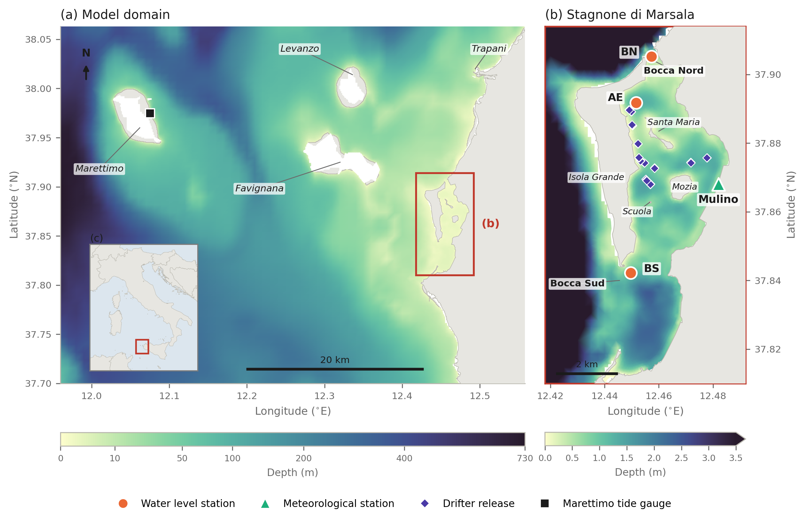
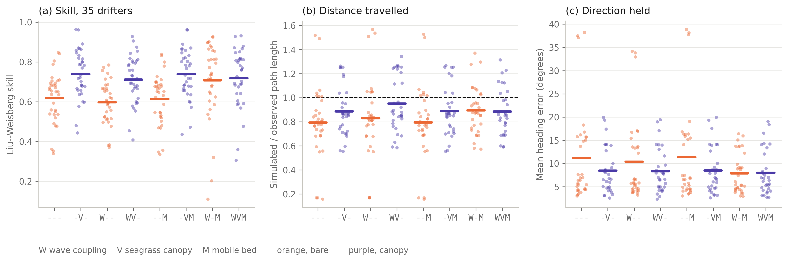
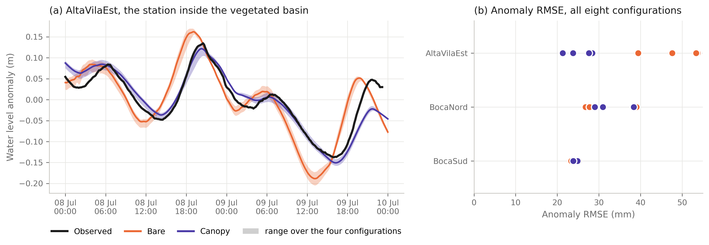

# Stagnone di Marsala Digital Twin

This repository holds a three-dimensional coupled wave and hydrodynamic model of the Stagnone di Marsala, a shallow vegetated lagoon on the western coast of Sicily. The model is built with Delft3D Flexible Mesh coupled to SWAN. The work is a PhD project at the Università degli Studi di Palermo. Runs are executed on a Linux server of the university (simit, Intel MPI) and on Windows workstations.

<p align="center">
  <br/>
  <em>Model domain, lagoon and observation stations.</em>
</p>

## Status, October 2026

| Area | Status |
|------|--------|
| Model configuration | `v04AE` lineage, 25,212-face mesh with 10 uniform sigma layers, SWAN on nested grids, CMEMS boundary with a per-node offset anchored at Marettimo, ERA5 wind blended with the AltaVilaEst record |
| Seagrass canopy | Three-dimensional drag through the `[veg]` module of D-Flow FM, with parameters from published measurements and a PlanetScope classification of August 2023; no parameter fitted to the validation data |
| Process ensemble | Complete 2 × 2 × 2 factorial in wave coupling, canopy and bed mobility over 1 to 10 July 2025, run from a stratified initial state |
| Validation | Three lagoon tide gauges, the Marettimo gauge offshore, and 35 surface drifters in twelve deployments withheld from model decisions |
| Paper 1 | Manuscript revised after internal review, with a Supplementary Material ([docs/paper1_revised_2026-10-27.pdf](docs/paper1_revised_2026-10-27.pdf), [docs/paper1_supplementary_2026-10-27.pdf](docs/paper1_supplementary_2026-10-27.pdf)); target journal *Estuarine, Coastal and Shelf Science* |
| Mobile bed | D-Morphology with two fractions runs, but the present parameters give implausible suspended load and bed change under waves; a plausibility sweep of the deposition threshold and skin friction is running on simit |
| WetWise portal | Published on EDITO, with surface fields, station series and vertical velocity sections |
| Infrastructure | Runs on simit through a shared core allocator; a 14.6 TB volume is mounted at `/storage` for long runs |

## Site

The Stagnone di Marsala is a shallow coastal lagoon on the western coast of Sicily.

- Area of about 22 km², about 11 km north to south and 2.5 km east to west, centred at 37.86° N, 12.46° E
- A northern sub-basin of about 1 m depth and a southern one of about 2 m, separated by a *Posidonia oceanica* barrier reef
- Islands of Mothia, Santa Maria and Scola
- Mean depth of about 0.95 m, with a maximum near 3 m
- Micro-tidal regime with a semi-diurnal amplitude of about 0.30 m
- Salinity from 33 to 46 over the year (Basso et al., 2008), reaching about 48 in the northern sub-basin in summer (Mancuso et al., 2023)
- *Posidonia oceanica* in the central and southern basin, as atolls and barrier-reef formations, and *Cymodocea nodosa* in the north
- Two inlets, Bocca Nord (about 400 m wide and 0.35 m deep, with a dredged channel) and Bocca Grande (about 2.9 km wide and 1.0 to 1.5 m deep)

Wind drives the east-west circulation and tidal exchange the north-south component. The wind-driven surface drift over a near-bed return flow reported by De Marchis et al. (2012) requires a vertically resolved model despite the sub-metre depth.

## Research questions

| # | Research question | Paper | Target journal |
|---|---|---|---|
| RQ1 | What is the 3D wind-driven flow structure in a sub-metre-deep vegetated lagoon, and how does it differ from depth-averaged dynamics? | Paper 1 | *ECSS* |
| RQ2 | Do wave–current coupling and spatially distributed seagrass canopy improve Lagrangian transport prediction, and what is the relative contribution of each? | Paper 1 | *ECSS* |
| RQ3 | Is Lagrangian drifter validation more discriminating than water-level metrics for evaluating competing model configurations in a micro-tidal lagoon? | Paper 1 | *ECSS* |
| RQ4 | How has the decline of *Posidonia oceanica* (2003–2025) altered wave attenuation, near-bed current exposure and water residence time, and what are the consequences of projected further cover loss? | Paper 2 | *ECSS* / *MEPS* |
| RQ5 | Can satellite-derived bathymetry capture bathymetric change accompanying seagrass decline (2023–2025) and constrain the sediment calibration? | Paper 4 (supporting) | *Continental Shelf Research* |
| RQ6 | Can the coupled model support short-range forecasts served through a web interface for lagoon management? | Paper 3 | *EMS* / *OCM* |
| RQ7 | Are wave events capable of mobilising lagoon sediment, and how much do fine-sediment inputs from the Trapani canal system (airport and saltpan drainage) contribute to lagoon siltation? | Paper 4 | *Continental Shelf Research* / *Geomorphology* |
| RQ8 | What would be the hydrodynamic and environmental impact of reopening the historic channel at Isola Grande, restoring exchange between the northern sub-basin and the open sea? | Paper 3 | *OCM* / *ECSS* |
| RQ9 | Does a velocity-dependent *Posidonia oceanica* resistance following the flume law of Ciraolo et al. (2006), S_f ∝ U^0.44, improve hydrodynamic skill and alter the simulated response to cover change relative to a fixed canopy drag? | Paper 2 | *ECSS* / *MEPS* |

## Model configuration

- **D-Flow FM** (Delft3D FM Suite 2026.01, kernel 1.2.184). The unstructured mesh has 21,188 nodes and 25,212 faces over 11.96–12.56° E and 37.70–38.06° N, grading from about 880 m offshore to about 60 m in the lagoon, so that about six cells span the northern inlet. The vertical has 10 sigma layers of uniform thickness. Turbulence uses the k–ε closure and density the UNESCO equation of state with active salinity and temperature. The bare-substrate roughness is a uniform Manning coefficient of 0.023 s m^-1/3. The adaptive time step runs under a Courant limit of 0.7, capped at 30 s with wave coupling and 15 s without, on eight MPI partitions.
- **SWAN** through Delft3D-WAVE, on an outer grid of about 800 m over the whole domain and an inner grid of about 90 × 110 m over the lagoon and its inlets. DIMR exchanges fields every 3600 s, and `ncFormat = 3` keeps the communication file readable by SWAN.
- **Boundary forcing** from CMEMS Mediterranean products, water level from the analysis and forecast product at 15 min, which carries the tide, and salinity, temperature and a depth-resolved advection velocity from the daily multi-year reanalysis. The CMEMS sea surface height is an anomaly about the NEMO rest state, so a per-node offset of +0.449 m, anchored on 384 days of the Marettimo gauge (JRC TAD 658) and spread along the boundary by the CMEMS mean dynamic topography, is added ([docs/marettimo_offset_anchor_2025.md](docs/marettimo_offset_anchor_2025.md)).
- **Atmospheric forcing** from ERA5 (wind, pressure, Charnock coefficient, evaporation as negative rainfall), with the wind blended with the AltaVilaEst station. Interior salinity and temperature are nudged to CMEMS with a relaxation time of 8.64 × 10^5 s.
- **Initial state** from the CMEMS depth profiles at the start time outside the lagoon and a hypersaline value of 42 inside it.
- **Seagrass canopy** as a drag per sigma layer over the height the plants occupy, following the quadratic form of Nepf (2012). *P. oceanica* values are from Ciraolo and Ferreri (2006) with the canopy height of 0.40 m from Prinos et al. (2010), and *C. nodosa* values are from Morris et al. (2008). Fractional cover from a random-forest classification of PlanetScope imagery (August 2023, 3 m), following the depth-invariant approach of Maltese et al. (2025), scales the stem density.
- **D-Morphology** with a sand fraction (d50 = 150 µm) and a silt fraction (d50 = 30 µm), with erodible sediment confined to depths above 15 to 20 m and suspended sediment kept out of the density field.

Parser and runtime issues of FM 2026.01 met while building the configuration are collected in [docs/fm_2026_gotchas.md](docs/fm_2026_gotchas.md) and [docs/fm_veg_module_setup.md](docs/fm_veg_module_setup.md).

## Model lineage

| Feature | v01 | v02 | v03a–c | v03d | v04 | v04AE | Ensemble |
|---------|:---:|:---:|:------:|:----:|:---:|:-----:|:--------:|
| Water-level boundary offset | 0.0 m | +0.42 m | +0.42 m | +0.42 m | per node | per node | per node |
| Blended wind |   | ✓ | ✓ | ✓ | AE + ERA5 + SiAM | AE + ERA5 | AE + ERA5 |
| Hypersaline initial state |   |   | ✓ | ✓ | ✓ | ✓ | ✓, stratified offshore |
| SWAN coupling |   |   | ✓ | ✓ | ✓ | ✓ | factor |
| `ncFormat = 3` |   |   |   | ✓ | ✓ | ✓ | ✓ |
| Trapani port mesh patch |   |   |   |   | ✓ | ✓ | ✓ |
| ERA5 evaporation |   |   |   |   | ✓ | ✓ | ✓ |
| Advection velocity at the boundary |   |   |   |   |   | ✓ | ✓ |
| Seagrass canopy |   |   |   |   |   |   | factor |
| Mobile bed |   |   |   |   | ✓ |   | factor |
| MPI partitions | 4 | 4 | 4 | 4 | 8 | 8 | 8 |

The eight members of the ensemble are coded by wave coupling (`W`), canopy (`V`) and mobile bed (`M`), with a dash where the factor is off. Their model directories and tags are listed in [scripts/_ensemble.py](scripts/_ensemble.py), where `STAGNONE_ENSEMBLE=ic3d` selects the members run from the stratified start. Each vegetated member is a three-day segment restarted on 7 July from the bare member of the same cell.

## Results of the process ensemble

### Lagrangian transport

Liu–Weisberg skill and endpoint separation of the 35 drifters, scored over the interval each drifter was in the water (8 to 10 July 2025), are given below.

| Member | Waves | Canopy | Mobile bed | LW skill | Endpoint (m) | Path ratio | Heading error |
|---|:---:|:---:|:---:|---:|---:|---:|---:|
| `---` | | | | 0.619 | 478 | 0.80 | 11.2° |
| `-V-` | | ✓ | | 0.739 | 327 | 0.88 | 8.5° |
| `W--` | ✓ | | | 0.597 | 481 | 0.83 | 10.4° |
| `WV-` | ✓ | ✓ | | 0.711 | 335 | 0.94 | 8.4° |
| `--M` | | | ✓ | 0.614 | 479 | 0.80 | 11.4° |
| `-VM` | | ✓ | ✓ | 0.739 | 330 | 0.88 | 8.5° |
| `W-M` | ✓ | | ✓ | 0.708 | 304 | 0.89 | 7.9° |
| `WVM` | ✓ | ✓ | ✓ | 0.718 | 307 | 0.88 | 8.0° |

On the fixed bed the canopy raises skill by 0.120 and 0.114, both bootstrap intervals clear of zero, against −0.022 and −0.028 for wave coupling. With waves the uncalibrated mobile bed brings the bare member to the skill of the vegetated ones, through bathymetry reshaped by implausible erosion. The four fixed-bed members therefore carry the process attribution, and the mobile-bed members form a sensitivity arm.

<p align="center">
  <br/>
  <em>Liu–Weisberg skill, path length ratio and heading error per drifter, fixed-bed members on the left and the mobile-bed arm on the right.</em>
</p>

### Water level

Anomaly RMSE (m), 8 to 10 July 2025, for the four fixed-bed members, is given below.

| Station | `---` | `-V-` | `W--` | `WV-` |
|---|---:|---:|---:|---:|
| BocaNord | 0.039 | 0.038 | 0.027 | 0.031 |
| BocaSud | 0.025 | 0.025 | 0.024 | 0.025 |
| AltaVilaEst | 0.054 | 0.028 | 0.048 | 0.021 |

The two gauges near the inlets differ by at most 4 mm between canopy treatments, and the gauge inside the vegetated basin separates them by 26 and 27 mm. Raw RMSE, bias, correlation and amplitude ratio of all eight members are in Table 2 of the manuscript. The relation RMSE² = bias² + RMSE_anom² separates the reference-level offset from the dynamic error, and the seasonal residual of the Marettimo anchor, about 0.07 m, bounds the accuracy of the reference level.

<p align="center">
  <br/>
</p>

### Sensitivity of the transport skill to numerical choices

| Test | Configuration | Result |
|---|---|---|
| Initial state | full ensemble repeated from a vertically uniform column (24 °C, 37.5) | the canopy effect rises from 0.12 to 0.19, the uniform start degrading only the bare member |
| Vertical resolution | 10 and 20 layers, stratified start, time step limited by vertical fluxes | +0.0003 in LW skill |
| Horizontal resolution | quadtree mesh family from 60 to 15 m, bare uncoupled member | LW skill 0.553 ± 0.004, the v04 mesh within the range |
| Lagoon bathymetry | 2026 survey raster in place of the 2006 bathymetry, bare uncoupled member | +0.016 in LW skill |
| Host and decomposition | same inputs on simit and on a workstation | difference traced to the Courant limit, not to the partitioning; comparisons are made within one host |

Design and results are documented in Section S6 of the Supplementary Material and in [docs/mesh_convergence_experiment.md](docs/mesh_convergence_experiment.md).

## Work in progress

1. **Paper 1.** Final figures of the Supplementary Material, including the bed-change and suspended-load maps of the mobile-bed arm, and submission to *ECSS*.
2. **Mobile-bed plausibility.** Three-day cold starts from 1 July with bed updating from the end of the first day, varying the deposition threshold of the silt (`TcrSed`), the skin-friction formulation of Soulsby (2004) (`BsSkin`), the critical erosion stress and the erosion parameter, and the canopy in SWAN through Dalrymple dissipation. The target is a lagoon silt concentration of a few to about 20 mg/l, bed change at the millimetre scale and a closed sediment volume balance, after which a nine-day mobile-bed arm is rerun.
3. **Paper 2.** Cover scenarios of 2003 and 2025 from the Maltese et al. (2025) maps, and the velocity-dependent resistance of RQ9.
4. **Paper 3.** Forecast chain on the CMEMS analysis and forecast product and the Isola Grande channel scenario.
5. **Paper 4.** Satellite-derived bathymetry from several PlanetScope scenes per year, where a single pair is dominated by radiometric offset, and the canal fine-sediment input.

## Publication plan

| Paper | Topic | RQs | Target journal | Status |
|---|---|---|---|---|
| P1 | Relative effects of seagrass canopy, wave coupling and bed mobility on transport, validated against tide gauges and drifters | RQ1–3 | *Estuarine, Coastal and Shelf Science* | Revised manuscript and Supplementary Material |
| P2 | Hydrodynamic and environmental response to *P. oceanica* decline, with the velocity-dependent canopy resistance | RQ4, RQ9 | *ECSS* / *MEPS* | Cover maps and canopy parameters available; scenario runs pending |
| P3 | Operational digital twin, CMEMS forecast chain and WetWise portal, with the Isola Grande channel scenario | RQ6, RQ8 | *EMS* / *OCM* | Portal published; channel mesh exists; no coupled run |
| P4 | Wave-driven resuspension and canal fine-sediment input, with the sediment calibration constrained by satellite-derived bathymetry | RQ5, RQ7 | *Continental Shelf Research* / *Geomorphology* | Feasibility established; calibration sweep running |

## WetWise portal

The portal at <https://minio.dive.edito.eu/oidc-cmartinsjr/wetwise-portal/index.html> serves the full-physics member on a base grid over the whole domain and a detail grid over the lagoon, with station series and perspective views of vertical velocity sections. The fields are regridded on simit by [scripts/regrid_wetwise_source.py](scripts/regrid_wetwise_source.py) and packed for the browser by [scripts/build_wetwise_hydrodynamics_demo.py](scripts/build_wetwise_hydrodynamics_demo.py).

## Notebook catalogue

Notebooks in `notebooks/` are grouped in numeric blocks. [notebooks/README.md](notebooks/README.md) gives the full index.

| Block | Notebooks | Role |
|-------|-----------|------|
| `00–09` | `00_setup_domain_mesh`, `01_input_satellite_roughness`, `02_input_insitu_wl_wind`, `03_input_blended_wind`, `04_input_cmems_waves` | Domain and input forcing |
| `10–19` | `10_build_v01`, `11_build_v02`, `12_build_v03`, `13_build_v03_wave_coupling` | Model configuration per version |
| `20–29` | `20_valid_v01_wl`, `21_valid_v03b`, `22_valid_v03c`, `23_valid_v03c_offshore`, `24_demo_wetwise_tab.py` | Validation and the first portal bundle |
| `30–39` | `30_analysis_v01_diagnostics`, `31_analysis_resuspension_feasibility`, `32_analysis_particle_tracking`, `33_analysis_residence_time` | Analyses |
| `40–49` | `40_util_edito_postproc`, `41_util_edito_map_subset` | EDITO tooling |

The ensemble post-processing (water level, drifter regridding and OpenDrift scoring, factorial contrasts, figures) lives in `scripts/` and reads the member list of [scripts/_ensemble.py](scripts/_ensemble.py).

## Execution

**simit.** Production runs are launched through `~/simit_tools/simit_pick_cores.sh`, which reserves cores per socket so that the MaltaDT and StagnoneDT workloads do not overlap. A coupled run takes 8 cores for FM and 8 OpenMP threads for SWAN. The partitioned output stays on the server, and the inputs are mirrored to the workstation after each batch ([docs/model_input_sync.md](docs/model_input_sync.md)). Outbound internet requires the GlobalProtect VPN.

**EDITO Datalab.** The `delft3dfmrun-docker` process remains available as a fallback ([docs/EDITO_WORKFLOW.md](docs/EDITO_WORKFLOW.md)).

## Setup

### Python environment

```bash
conda env create -f environment.yml -n dfm_tools_env
conda activate dfm_tools_env
python -m ipykernel install --user --name dfm_tools_env --display-name "dfm_tools (Python 3.12)"
```

The environment carries dfm_tools 0.45.0 and HYDROLIB-core 1.0.0.

### Delft3D FM

D-Flow FM Suite 2026.01 HMWQ (`dflowfm 1.2.184`), installed at `C:\Program Files\Deltares\Delft3D FM Suite 2026.01 HMWQ\` on Windows and under `~/Scaricati/delft3dfm/lnx64/` on simit.

### Credentials

- **CMEMS** through the `copernicusmarine` login cache
- **ERA5 (CDS)** through `CDSAPI_URL` and `CDSAPI_KEY` in `.env`, with `pip-system-certs` on Windows for SSL
- **CDSE, Planet and EDITO** in `.env`

`.env.example` is the template, and `.env` is never committed.

## Project structure

```
StagnoneDT/
├── notebooks/             # input forcing, mesh, model build and coupling pipelines
├── scripts/               # build, run, regrid, validation and figure scripts
├── docs/                  # methodology, gotchas, reports, Paper 1 PDFs and review summaries
├── manuscript/            # Paper 1, first LaTeX version
├── manuscript_v2/         # Paper 1, revised LaTeX version and Supplementary Material
├── model/
│   ├── dflowfm .. dflowfm_v03d/    # v01 to v03d
│   ├── dflowfm_v04/, dflowfm_v04AE/ # v04 lineage
│   ├── dflowfm_v04AE_*/            # ensemble members and sensitivity tests
│   └── _veg_*/                     # vegetated segments restarted on 7 or 8 July
├── data/
│   ├── raw/               # in-situ stations, drifters, Marettimo, CMEMS, ERA5, bathymetry
│   └── processed/         # QC'd series, seagrass classification, drifter metrics
├── outputs/wetwise_tab/   # portal payloads and section views
├── oldModel/              # reference models A and B and the 2006 bathymetry (read-only)
├── reference/             # third-party material; papers gitignored
├── figures/               # generated figures
├── environment.yml
└── .env.example
```

Partitioned output (`DFM_OUTPUT_*/`) is never committed, at 16 to 38 GB per run.

## Documentation

- [docs/fm_2026_gotchas.md](docs/fm_2026_gotchas.md), parser and configuration issues of FM 2026.01 for evaporation, D-Morphology and SWAN
- [docs/fm_veg_module_setup.md](docs/fm_veg_module_setup.md), the `[veg]` canopy module and its inputs
- [docs/marettimo_offset_anchor_2025.md](docs/marettimo_offset_anchor_2025.md), the Marettimo anchor of the boundary offset
- [docs/wl_boundary_offset_justification.md](docs/wl_boundary_offset_justification.md), components of the water-level offset
- [docs/mesh_convergence_experiment.md](docs/mesh_convergence_experiment.md), design and cost of the mesh and layer tests
- [docs/deltares_hdf5_coupling_report.md](docs/deltares_hdf5_coupling_report.md), the HDF5 re-open failure of the communication file and the `ncFormat = 3` remedy
- [docs/deltares_modelbuilder_observation.md](docs/deltares_modelbuilder_observation.md), double counting of the tide in a CMEMS plus TPXO boundary
- [docs/deltares_report_2026-09-01.md](docs/deltares_report_2026-09-01.md), observations on the vegetation and roughness stack for Deltares
- [docs/deltares_byom_2026-11-04.md](docs/deltares_byom_2026-11-04.md), topics for the Bring Your Own Model session of the Delft3D User Days 2026
- [docs/sediment_calibration_references.md](docs/sediment_calibration_references.md), sources for the sediment parameters
- [docs/paper1_review_summary_2026-10-27.md](docs/paper1_review_summary_2026-10-27.md), the internal review of Paper 1 and its implementation
- [docs/research_questions_status.md](docs/research_questions_status.md), status of the research questions
- [docs/EDITO_WORKFLOW.md](docs/EDITO_WORKFLOW.md), EDITO Datalab operation

## License

Public repository. No license specified.
