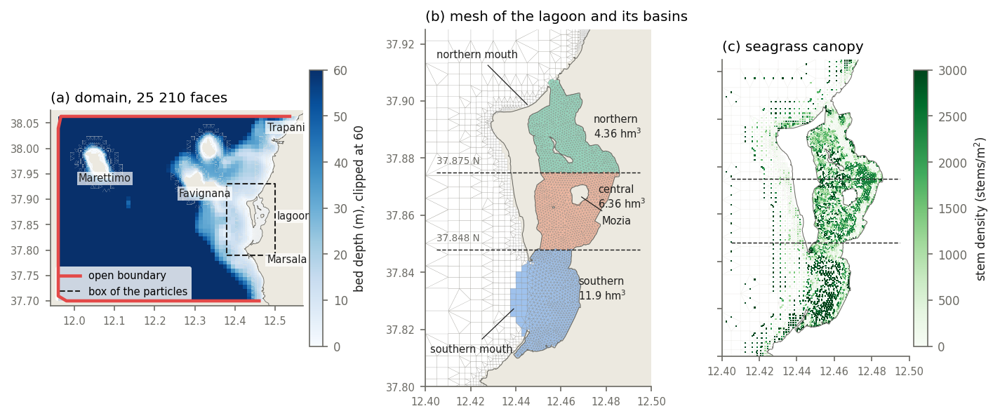
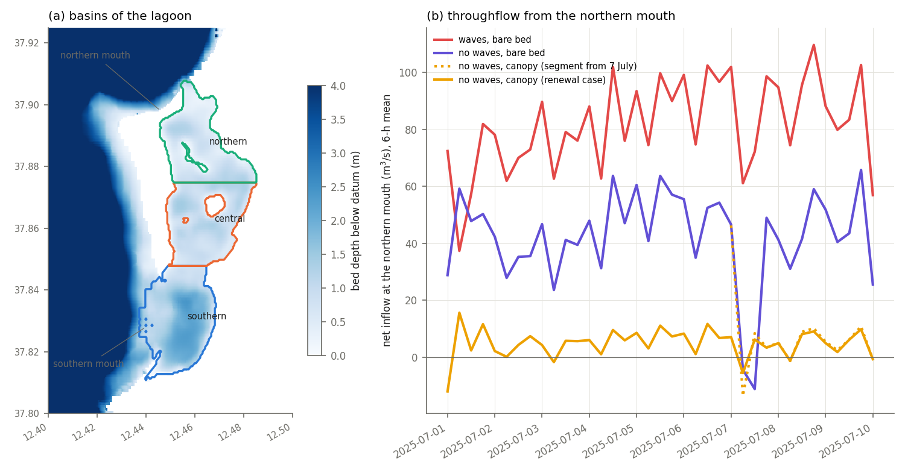
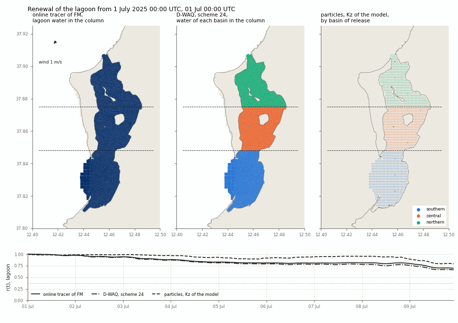
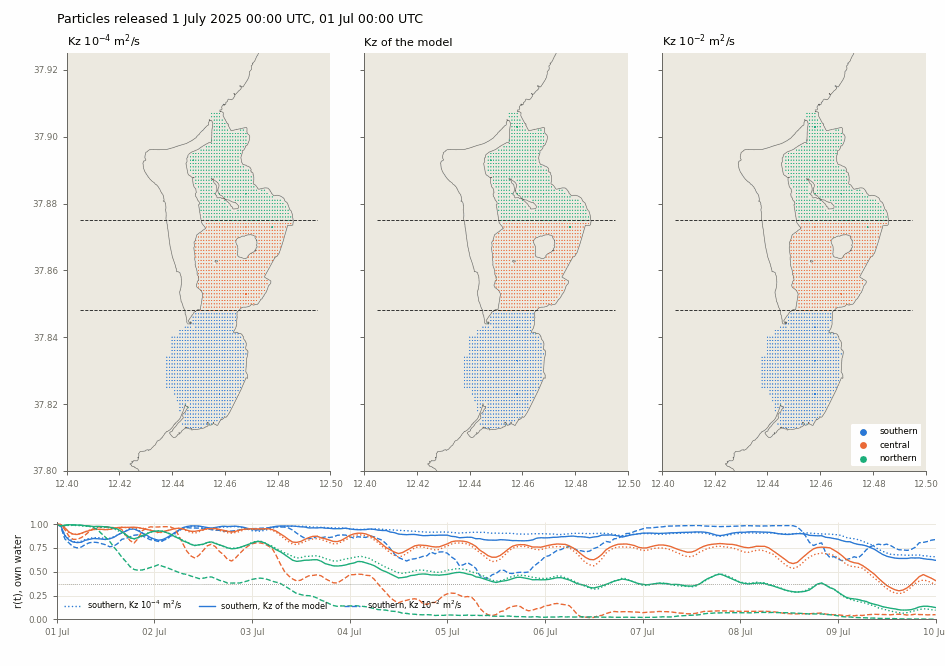
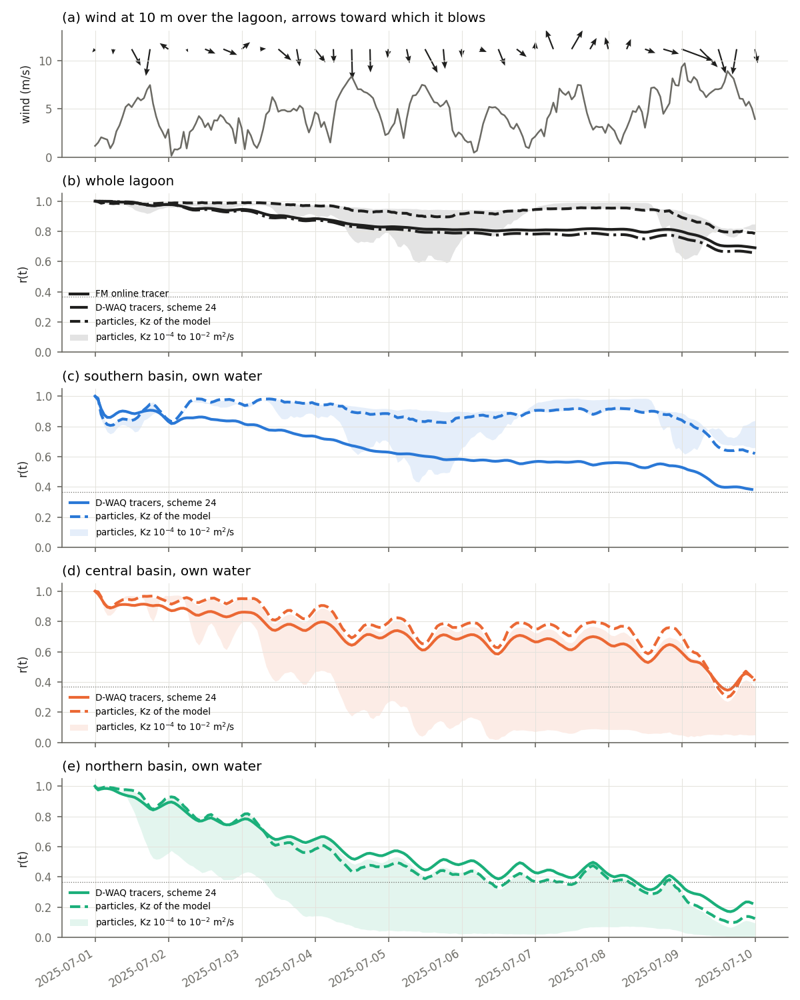
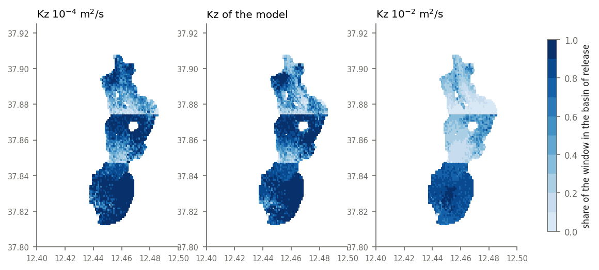
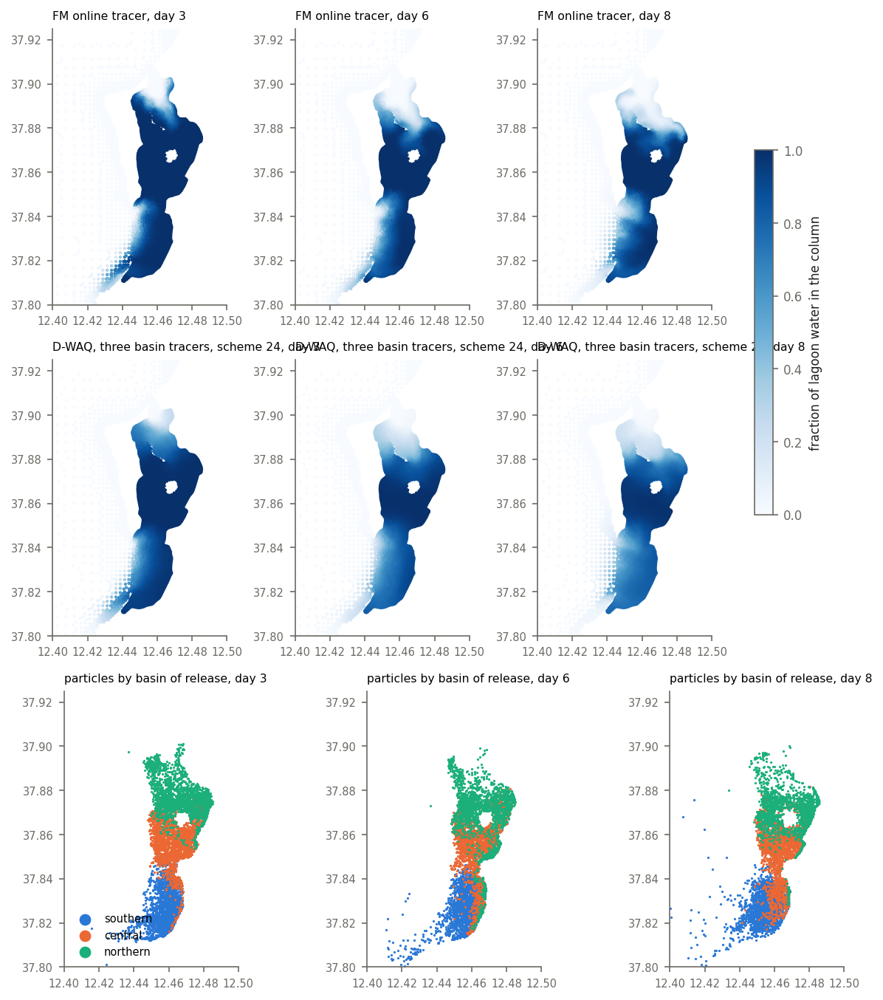

# Renewal of the Stagnone lagoon, 1 to 10 July 2025

*Hydrodynamic case built by `scripts/setup_renewal_case_simit.sh` and read by `scripts/postrun_renewal_case_simit.sh` on simit-server. Online tracer read by `scripts/renewal_tracer_member.py`, throughflow by `scripts/diagnose_lagoon_throughflow.py`, currents for the particles extracted by `scripts/extract_lagoon_currents_3d.py`, particles run by `scripts/renewal_lagoon_opendrift.py`, D-Water Quality input written by `scripts/build_renewal_waq.py` and read by `scripts/renewal_waq_member.py`, figures drawn by `scripts/figure_lagoon_renewal.py`. Basins and lagoon mask in `scripts/renewal_common.py`. The case and its outputs lie under `/storage/ciceromartinsjr/StagnoneDT/renewal/` on simit-server and under `outputs/renewal/` locally, regenerated by the scripts and not versioned.*

The residence time of the water of the lagoon enters RQ4 of [research_questions_status.md](research_questions_status.md), which asks how the decline of the seagrass cover has changed it. The computation reported here gives the time scales of renewal of the lagoon and of its three basins under the present cover, for one hydrodynamic case of nine days, by three readings of the same hydrodynamics: the conservative tracer carried online by D-Flow FM, particles advected offline by OpenDrift, and conservative tracers advected offline by D-Water Quality (D-WAQ). The approach follows the renewal study of the Grand Harbour of Valletta in the MaltaDT repository (`MaltaDT/docs/harbour_renewal_particles.md`), which used particles alone, since the D-WAQ output of that model was not written.

## Summary

The vegetated, fixed-bed member without wave coupling was run from a cold start with stratified initial salinity and temperature on 1 July 2025 to the end of the forcing on 10 July, writing the hydrodynamics for D-WAQ every 30 minutes and the vertical eddy viscosity to the map output (Section 2). The lagoon of 21.9 km² and 22.6 hm³ is divided by latitude into a southern, a central and a northern basin (Section 3).

The water of the lagoon does not reach the e-folding fraction within the nine days in any of the readings. The fraction of the initial lagoon water still inside the lagoon on 10 July is 0.69 by the online tracer, 0.66 by D-WAQ and 0.79 by the particles, and an exponential fitted after the first day gives e-folding times of 26 to 32 days by the two Eulerian readings and 57 days by the particles (Section 7). The northern basin renews in about a week, the central basin passes its water southward, and the southern basin exports to the sea through the southern mouth. The exchange is organised as a slow north-to-south throughflow of 5 to 6 m³/s under the canopy, set by a sea-level difference of about 3 cm between the two mouths along the coast (Section 5). Without the canopy the same difference drives 42 to 85 m³/s and flushes the lagoon in about four days. The salinity measured in July by Mancuso et al. (2023), highest in the northern basin, does not support a renewal that starts in the north, and the realism of the coastal sea-level difference remains the first open matter (Section 11).

The two Eulerian readings agree within 0.1 on the lagoon water held by each basin. The particles retain more water in the southern basin, where the volume they represent is not conserved (Section 9).

## 1. Measures of renewal

A volume V₀ of water is marked inside a basin at time t₀. The remaining fraction r(t) is the part of V₀ found inside the same basin at time t, which starts at 1 and falls as the marked water leaves and is replaced. Water that leaves and returns counts again on return, so r(t) need not decrease monotonically. Three time scales follow from r(t).

1. The e-folding time τ, at which r(t) first falls below 1/e ≈ 0.37. For a well-mixed basin exchanging with an unlimited reservoir at a constant rate, r(t) = exp(−t/τ) and τ is the ratio of volume to exchange flow.
2. The mean residence time θ = ∫₀^∞ r(t) dt of Takeoka (1984), the average time a marked parcel spends inside the basin before it leaves for good. Over a window W the integral is truncated at W and is a lower bound on θ.
3. The times t₉₅ and t₉₉ at which r = 0.05 and 0.01. With r(t) = A exp(−t/τ_fit) they are t = τ_fit ln(A/r).

The exponential is fitted to ln r(t) by least squares after the first day, which leaves out the initial exchange of the water nearest the mouths, and τ_fit, t₉₅ and t₉₉ extrapolate beyond the window under the assumption that the rate of the nine days persists.

The online tracer of FM marks the whole lagoon with one substance and cannot separate the water of one basin from that of another. For each basin it gives the content of lagoon water, the volume of initial lagoon water inside the basin divided by the volume of the basin, and r(t) in the strict sense only for the lagoon as a whole. The particles and the D-WAQ tracers mark each basin separately and give r(t) for each basin, together with the matrix of where the water of each basin lies at the end, called its fate in what follows.

## 2. Hydrodynamic case

| Element | Setting |
|---|---|
| Member | vegetated, fixed bed, no wave coupling (`-V-` in the eight-member factorial of wave coupling, vegetation and mobile bed), from `model/_veg_hv040_3d_ic3d`; canopy in the `[veg]` module with a canopy height of 0.40 m |
| Initial condition | cold start on 1 July 2025 00:00 UTC with the stratified salinity and temperature of `dflowfm_v04AE_nowaves_ic3d` |
| Window | 1 to 10 July 2025, the end of the boundary and meteorological forcing |
| Mesh | 25 210 faces, refined to 15 m inside the lagoon and at its mouths and coarsening offshore to the islands of the Egadi archipelago |
| Vertical | 10 uniform sigma layers |
| Open boundary | one polyline along the southern (37.70 N), western (11.96 E) and northern (38.06 N) edges; water level as the sum of the CMEMS sea level and a per-node offset anchored at the Marettimo gauge ([marettimo_offset_anchor_2025.md](marettimo_offset_anchor_2025.md)), CMEMS current, salinity and temperature, and the lagoon tracer at 0 |
| Surface | wind of ERA5 blended with the record of the AltaVilaEst station on the eastern flank of the central basin, ERA5 pressure, Charnock coefficient and evaporation less rainfall |
| Changes against the member | no restart file, `maxVelocity` 25 m/s as in the cold-start members, `waqInterval` 1800 s, `wrimap_turbulence` 1 |
| Run | 8 MPI ranks on socket 1 of simit-server, map output every 30 minutes |

The lagoon tracer of FM starts at 1 inside the lagoon, as given by `lagoon_tracer_init.xyz`, and at 0 elsewhere.

*Bed depth of the domain clipped at 60 m, with the open boundary in red and the box of the currents given to the particles dashed (a). Mesh of the lagoon, its faces shaded by basin, the two latitudes that divide the basins dashed, and the volume of each basin on 1 July (b). Stem density of the canopy in the `[veg]` module, with the same divisions (c). The faces are those of the mesh merged by `waqmerge`, on which D-WAQ computes.*

## 3. Lagoon and basins

A face of the mesh belongs to the lagoon when the nearest sample of `lagoon_tracer_init.xyz` lies within 150 m and carries the value 1. The distance of 150 m reproduces the face volumes of the lagoon on the 50 m grid of the particles, where 50 m left out part of the southern basin. The basins are separated at 37.848 N and 37.875 N, which places the southern mouth in the southern basin, the island of Mozia in the central basin and the northern mouth in the northern basin (`figures/renewal_case.png`, panel b). The southern basin includes the faces of the southern mouth and of the shallows west of it to 12.425 E, which the initial field of the online tracer counts as lagoon. The division at 37.848 N lies at the narrowing of the lagoon between the central and southern basins, about 1.4 km wide, and the division at 37.875 N lies just north of Mozia, where the lagoon is about 3 km wide, so that the boundary between the central and northern basins is a convention of this study and not a constriction of the water body.

| Basin | Volume on 1 July (hm³) | Faces of the mesh |
|---|---|---|
| Southern | 11.9 | 1268 |
| Central | 6.36 | 1513 |
| Northern | 4.36 | 1462 |
| Lagoon | 22.6 | 4243 |

## 4. The three readings

### 4.1 Online tracer of FM

The mass of the tracer in each region is the layer-mean concentration times the water depth and the face area, summed over the faces owned by each partition, which are those whose `mesh2d_flowelem_domain` equals the partition number.

### 4.2 Particles in OpenDrift

| Element | Setting |
|---|---|
| Currents | the three-dimensional velocity of the map output interpolated onto a grid of 0.0005° (about 44 by 55 m, 241 by 281 points) and 12 fixed depths from 0.1 to 20 m, every 30 minutes |
| Vertical diffusivity | the eddy viscosity of FM divided by a turbulent Prandtl number of 0.7, and constant values of 10⁻⁴ and 10⁻² m²/s as bounds |
| Horizontal diffusivity | 0.1 m²/s |
| Release | every second grid point of the lagoon deeper than 0.2 m, three particles per column at the centres of three equal parts of the column, 6549 particles (2466 southern, 2109 central, 1974 northern), each carrying its share of the column volume |
| Time steps | 300 s for advection, 60 s for vertical mixing |
| Model | `OceanDrift` of OpenDrift 1.14.9 |

The eddy diffusivity of the model inside the lagoon has a median of 2 × 10⁻⁴ m²/s and a 90th percentile of 8 × 10⁻⁴ m²/s, near the lower of the two bounds. A particle that leaves the box of the currents, 12.38 to 12.50 E and 37.79 to 37.93 N, is deactivated and counted as renewed.

### 4.3 Conservative tracers in D-WAQ

The hydrodynamics written by FM every 30 minutes for each partition is joined by `waqmerge` into one set of volumes, flows, areas, lengths, pointers and vertical diffusivities over 252 100 segments in 10 layers. Four conservative tracers are carried on it: one for the water of each basin, at 1 in its basin and 0 elsewhere at the start, and one for the sea, at 1 outside the lagoon at the start and on the open boundary throughout. The four sum to 1 in every segment for a transport that is linear and conservative, which serves as a check.

| Element | Setting |
|---|---|
| Horizontal transport | scheme 15, implicit upwind of first order, and scheme 24, flux corrected with a locally varying implicitness; both free of a Courant limit on the 15 m faces |
| Vertical transport | the eddy diffusivity of FM through the process `VertDisp` |
| Time step | 5 minutes, map output every hour |
| Run time | about 70 minutes for scheme 15 and 10 minutes for scheme 24, one core of simit-server |

The volume change of each segment between two records equals the summed flows over the interval within 1 per cent in all but a few hundred of the 205 650 wet segments, which places the hydrodynamics given to D-WAQ in balance. The sum of the four tracers inside the lagoon drifts upward over the window, by 0.8 per cent averaged over the volume for scheme 15 and by 1.1 per cent for scheme 24, with a 99th percentile of 1.4 and 15 per cent respectively. The larger local departure of scheme 24 follows from its flux limiter, which acts on each tracer separately and is not linear. Outside the lagoon the sum reaches 9 to 14 in sea faces of 5 to 30 m³ that dry and wet again, whose mass is negligible. The figures use scheme 24, and the difference between the two schemes is taken as the numerical uncertainty of the D-WAQ reading.

## 5. Throughflow of the lagoon

The net discharge across the faces that separate the sea from the southern and northern basins, and the basins from one another, was summed from the edge discharges of the map output after the first day.

| Member | Sea into the northern basin (m³/s) | Southern basin to the sea (m³/s) |
|---|---|---|
| Waves, bare bed (`v04AE_nodm`) | 85 | 87 |
| No waves, bare bed (`dflowfm_v04AE_nowaves_ic3d`) | 42 | 49 |
| No waves, canopy, segment from 7 July (`_veg_hv040_3d_ic3d`) | 5.9 | 23 |
| No waves, canopy, renewal case | 5.1 | 10 |

*Bed depth of the box of the currents given to the particles, with the outline of each basin on its grid of 0.0005° (a), and the net inflow from the sea into the northern basin averaged over six hours in the four members of the table (b). The two canopy runs share a hue, dotted for the segment that starts on 7 July.*

In every member the water enters by the northern mouth and leaves by the southern one. The coastal sea level averaged over the window stands about 3.3 cm higher next to the northern mouth than next to the southern mouth in the bare and canopy members without waves, and 7.9 cm higher with waves, a difference that originates north of 37.91 N along the coast. The same difference drives a throughflow fifteen times smaller under the canopy than over the bare bed, so the magnitude of the throughflow is set by the resistance inside the lagoon. At 85 m³/s the volume of the lagoon passes through it in about three days, which is not compatible with the hypersaline summer water of the lagoon, whereas at 5 m³/s it would take some 50 days. Mancuso et al. (2023) measured in July a salinity of 51.45 psu in the northern basin, 41.56 psu in the central basin and 38.40 psu next to the southern mouth, a gradient that places the most confined water in the north and so questions the direction of the throughflow, since the model renews the northern basin first with sea water entering by the northern mouth. The same authors give an exchange of about 22 m³/s through the southern mouth. The outflow at the southern mouth of the canopy members exceeds the inflow at the northern one by 5 to 17 m³/s while the volume of the lagoon stays within 1 per cent, which places a part of the exchange across faces outside the two sections summed here.

## 6. Course of the renewal over the window

*The three readings every two hours from 1 July 00:00 to 9 July 22:00 UTC. Left, the fraction of initial lagoon water in the column by the online tracer of FM, white for sea water. Centre, the water of each basin in the column by D-WAQ with scheme 24, the hue of a face mixing the colours of the three basins in proportion to their tracers and fading to white with the share of sea water. Right, the particles under the diffusivity of the model at all depths, coloured by basin of release. The arrow gives the direction toward which the wind over the lagoon blows, and the lower panel the remaining fraction of the lagoon by the three readings with the instant of the frame.*

In all three readings the water of the northern basin is replaced first, from its mouth, and by 5 July reaches into the central basin, whose water has in turn moved into the southern basin. The southern basin loses its water to the sea through the southern mouth and the shallows west of it, and a plume of lagoon water runs south along the coast to the open boundary. In D-WAQ the waters of the three basins mix across the divisions, while the particles keep sharper fronts between them.

*Positions of the particles every two hours from 1 July 00:00 to 10 July 00:00 UTC under Kz = 10⁻⁴ m²/s (left), the diffusivity of the model (centre) and 10⁻² m²/s (right), at all depths, coloured by basin of release. The lower panel gives the remaining fraction of the own water of each basin, dotted for 10⁻⁴ m²/s, solid for the model and dashed for 10⁻² m²/s.*

Under the two weaker diffusivities the particles spread through the lagoon in nearly the same pattern. Under 10⁻² m²/s the particles of the central and northern basins move south within three days and gather along the eastern shore of the southern basin, the convergence that Section 9 relates to the volume they carry.

## 7. Remaining fraction and time scales

| Reading | Region | r on 10 July | τ (d) | θ truncated (d) | τ_fit (d) | t₉₅ (d) |
|---|---|---|---|---|---|---|
| FM online tracer | lagoon | 0.69 | not reached | 7.7 | 32 | 95 |
| D-WAQ, scheme 24 | lagoon | 0.66 | not reached | 7.5 | 26 | 78 |
| D-WAQ, scheme 15 | lagoon | 0.63 | not reached | 7.2 | 23 | 69 |
| Particles, model diffusivity | lagoon | 0.79 | not reached | 8.5 | 57 | 173 |
| D-WAQ, scheme 24 | southern | 0.38 | not reached | 5.9 | 12 | 35 |
| Particles, model diffusivity | southern | 0.62 | not reached | 7.9 | 34 | 103 |
| D-WAQ, scheme 24 | central | 0.43 | 8.5 | 6.3 | 14 | 41 |
| Particles, model diffusivity | central | 0.41 | 8.5 | 7.0 | 13 | 40 |
| D-WAQ, scheme 24 | northern | 0.23 | 7.4 | 5.0 | 6.7 | 20 |
| Particles, model diffusivity | northern | 0.12 | 5.4 | 4.6 | 5.2 | 16 |

*Wind at 10 m over the centre of the lagoon, with arrows toward which it blows every six hours (a). Remaining fraction of the lagoon by the online tracer of FM, by D-WAQ with scheme 24 and by the particles under the diffusivity of the model, the shaded band spanning the particles under 10⁻⁴ and 10⁻² m²/s (b). Remaining fraction of the own water of each basin by D-WAQ and by the particles (c to e). The dotted line marks 1/e.*

The fractions of the particles under the two constant diffusivities bracket those under the model diffusivity. At 10⁻⁴ m²/s the central and northern basins keep 0.37 and 0.10, and at 10⁻² m²/s they keep 0.05 and 0.00, since a well-mixed column exposes the bottom water to the surface current that carries the throughflow.

The central basin loses water in tidal oscillations superposed on a trend, and the lagoon as a whole loses most of its water on 4 to 5 July and on 9 July, under northerly to north-westerly wind of 7 to 9 m/s, with little change in between. The extrapolated times therefore depend on the wind of the window, by a factor that one case of nine days cannot measure.

## 8. Fate of the water of each basin

| Basin of release | Reading | In the southern basin | In the central basin | In the northern basin | In the sea |
|---|---|---|---|---|---|
| Southern | D-WAQ, scheme 24 | 0.38 | 0.01 | 0.00 | 0.61 |
| Southern | Particles, model diffusivity | 0.62 | 0.00 | 0.00 | 0.38 |
| Central | D-WAQ, scheme 24 | 0.46 | 0.43 | 0.03 | 0.07 |
| Central | Particles, model diffusivity | 0.56 | 0.41 | 0.01 | 0.03 |
| Northern | D-WAQ, scheme 24 | 0.10 | 0.68 | 0.23 | 0.00 |
| Northern | Particles, model diffusivity | 0.08 | 0.76 | 0.12 | 0.04 |

The sea column of D-WAQ includes the water that left the domain through its open boundary. Both readings place the water of each basin in the next basin to the south, with the northern water filling the central basin and the central water the southern basin, and only the southern basin exchanges directly with the sea. Of the southern water that reaches the sea in D-WAQ, 0.34 of the basin volume leaves the domain through the southern open boundary at 37.70 N, carried by the coastal current, and 0.27 remains in the sea of the domain. The online tracer of FM shows the same export, its domain total falling to 0.84 of the initial lagoon mass by 10 July.

The particles released next to the southern limit of the northern and central basins leave their basin first, within a fraction of the window, while those of the north-western lobe of the northern basin and of the interior of the central and southern basins remain in it for most of the window.

*Share of the nine days that the particles of each seeded column spend inside their basin of release, averaged over the three particles of the column with their volumes as weights, under 10⁻⁴ m²/s (left), the diffusivity of the model (centre) and 10⁻² m²/s (right).*

In the maps of lagoon water the replacement advances from the northern mouth into the northern basin and from the southern mouth along the west side of the southern basin.

*Fraction of initial lagoon water in the column by the online tracer of FM (top) and by the sum of the three basin tracers of D-WAQ with scheme 24 (middle), and the particles under the diffusivity of the model coloured by basin of release (bottom), on 4, 7 and 9 July at 00:00 UTC, days 3, 6 and 8 of the window.*

## 9. Agreement between the readings

The content of initial lagoon water in each basin on 10 July is available from all three readings, from the fate matrices weighted by the basin volumes in the case of the particles and of D-WAQ.

| Reading | Southern | Central | Northern |
|---|---|---|---|
| FM online tracer | 0.74 | 0.94 | 0.20 |
| D-WAQ, scheme 24 | 0.67 | 0.91 | 0.28 |
| D-WAQ, scheme 15 | 0.61 | 0.90 | 0.29 |
| Particles, model diffusivity | 0.95 | 0.93 | 0.13 |
| Particles, 10⁻⁴ m²/s | 1.00 | 0.93 | 0.10 |
| Particles, 10⁻² m²/s | 1.46 | 0.29 | 0.00 |

The two Eulerian readings agree within 0.08 in every basin. The online tracer of FM keeps more water in the southern basin than D-WAQ, and the less diffusive scheme 24 of D-WAQ comes closer to it than scheme 15, so the remaining difference is attributed to the numerical diffusion of the offline transport at the southern mouth, where the tidal exchange mixes the ebb water with the sea.

The particles agree with the Eulerian readings in the central and northern basins and depart from them in the southern basin, where their content of lagoon water reaches 1.46 under the strong diffusivity. A content above 1 means that the particles concentrate in the southern basin beyond the volume they were given at release, so the volume they carry is not conserved there. The velocity interpolated onto the fixed depths of the particle grid is not divergence free in a basin of 0.5 to 1.5 m with sigma layers of 5 to 15 cm, and the particles gather where the interpolated field converges. The particles also leave the southern mouth on the ebb and return on the flood without mixing, which the Eulerian tracers do not permit. The particle reading is therefore used for the pathways between basins and for the local residence, where it agrees with D-WAQ, and the Eulerian readings for the remaining fraction of the southern basin and of the lagoon.

## 10. Configuration of D-WAQ on the hydrodynamics of FM 2026.01

| Item | Setting or behaviour |
|---|---|
| Hydrodynamics | `waqInterval` in the MDU of each partition, joined after the run by `run_waqmerge.sh <mdu>`, which writes the `.hyd` file and its binary companions in `DFM_DELWAQ_<model>/` |
| Initial conditions | `INITIALS '<substance>' ALL DATA ...` for each substance; without `ALL` delwaq stops with a segmentation fault while reading block 8 |
| Layers | no `MULTIGRID ZMODEL` block for sigma layers, whose `.hyd` carries no z-layer keys |
| Vertical dispersion | `SEG_FUNCTIONS 'VertDisper' LINEAR ALL BINARY_FILE <vdf>` with the constants `ONLY_ACTIVE` and `ACTIVE_VertDisp` set to 1 |
| Map output | NetCDF on the UGRID geometry of `<model>_waqgeom.nc`, time named `nTimesDlwq`; the record at the last instant of the hydrodynamics is written with flows that no longer match the volumes and is left out |
| Volumes | `.vol` holds, for each record, a 4-byte integer time in seconds from the reference time followed by one 4-byte real per segment |

## 11. Matters open

1. The coastal sea-level difference of about 3 cm between the two mouths drives the throughflow in every member, and its origin north of 37.91 N along the coast has not been traced to the boundary forcing, to the offshore dynamics or to the wind. The salinity of the model in the northern basin over the window, set against the gradient measured by Mancuso et al. (2023), is the direct test of the north-to-south throughflow.
2. The faces through which the outflow at the southern mouth exceeds the inflow at the northern mouth have not been located.
3. The window ends with the forcing on 10 July, before the lagoon reaches 1/e in any reading. Under the rate of the nine days the lagoon would reach 1/e after three to four weeks by the Eulerian readings and 0.05 after 70 to 95 days, so a run of two to three months, with forcing prepared beyond that date, would measure τ directly, test the exponential extrapolation of the tail, and allow repeated releases under different winds.
4. The age tracers of D-WAQ (processes `Age1` and `AgeCART`) give the mean age of the water at each point and would map the renewal without the division into basins.
5. RQ4 requires the same computation under the cover of 2003 and under further loss of cover, with the canopy parameters of the present case.
6. The box of the particles ends at 37.79 N, inside the reach of the coastal current that carries the southern water out of the domain, so the particles leaving it are counted as renewed although part of them would return.

## References

Dagestad, K.-F., Röhrs, J., Breivik, Ø. and Ådlandsvik, B. (2018). OpenDrift v1.0, a generic framework for trajectory modelling. *Geoscientific Model Development* 11, 1405–1420.

Mancuso, F.P. et al. (2023). Life on the edge: adaptations of *Posidonia oceanica* to hypersaline conditions in a Mediterranean lagoon system. *Environmental and Experimental Botany* 210, 105320.

Takeoka, H. (1984). Fundamental concepts of exchange and transport time scales in a coastal sea. *Continental Shelf Research* 3, 311–326.
