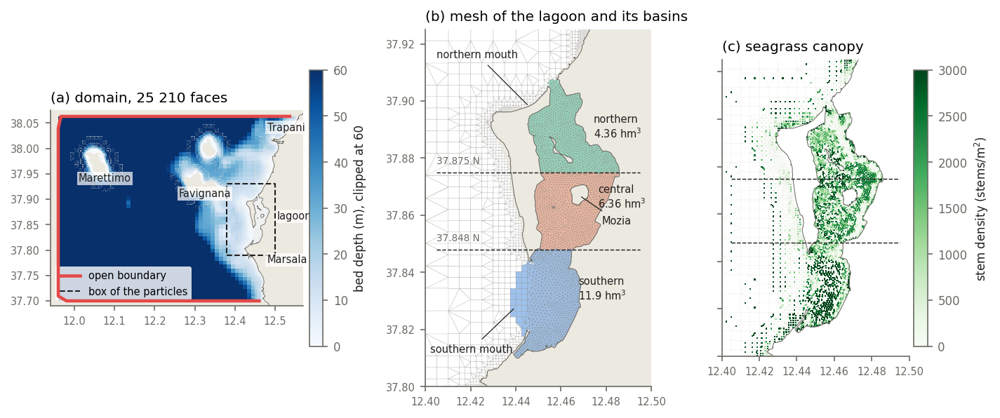
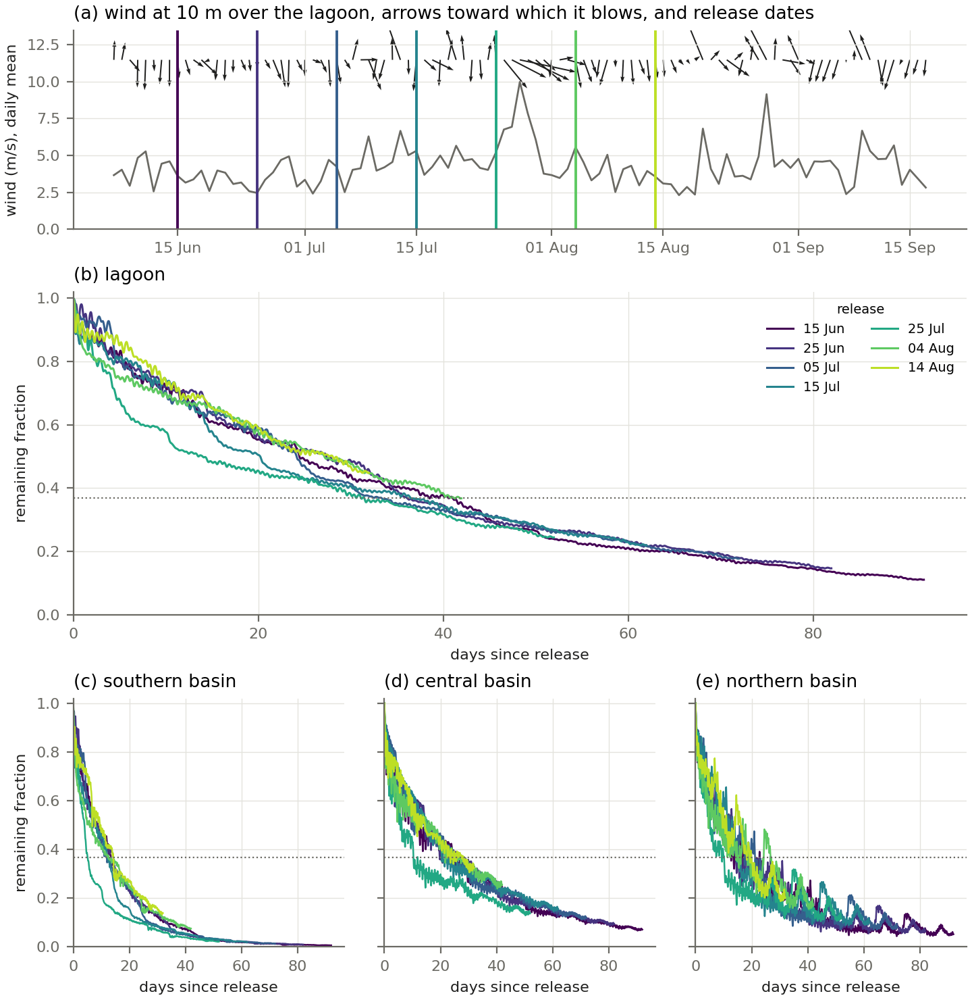
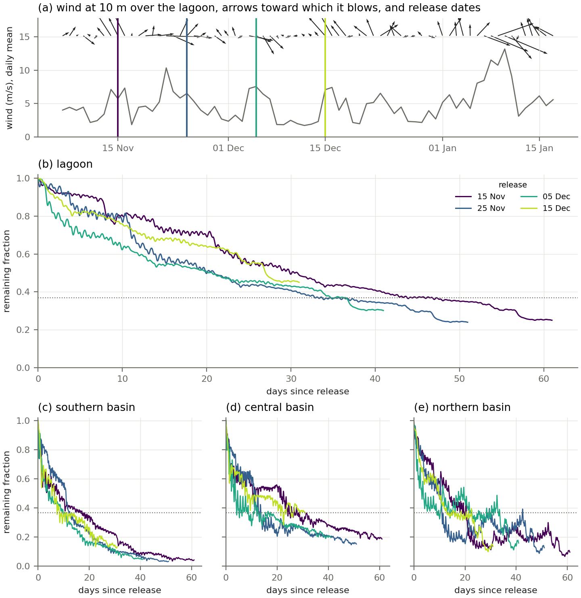
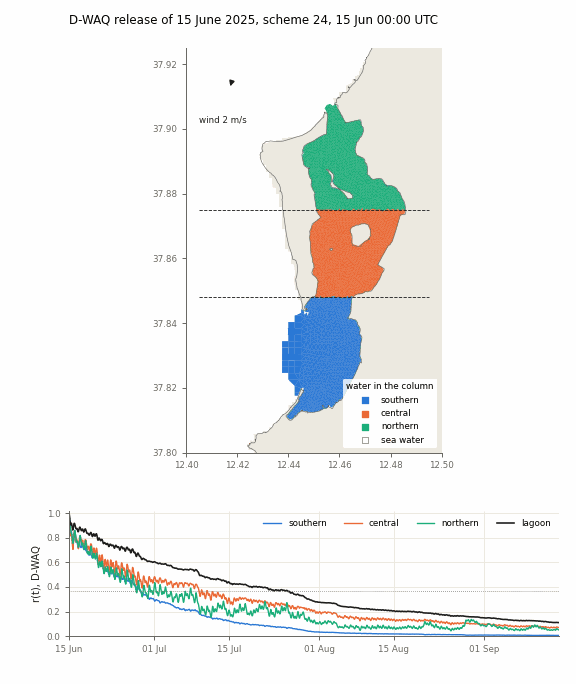
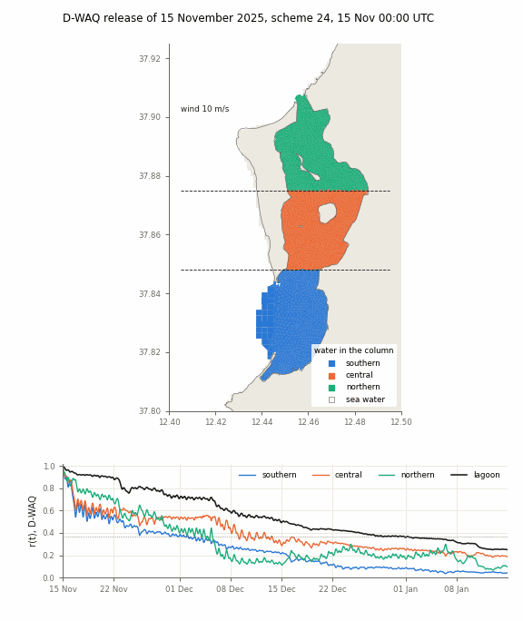
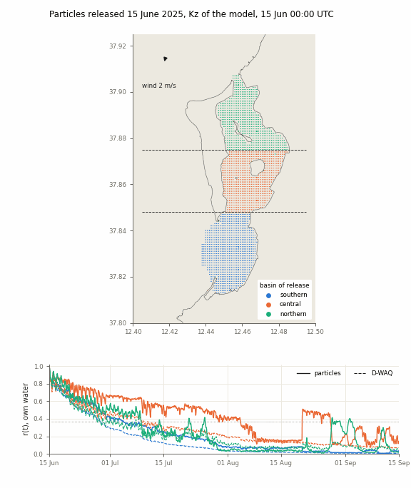
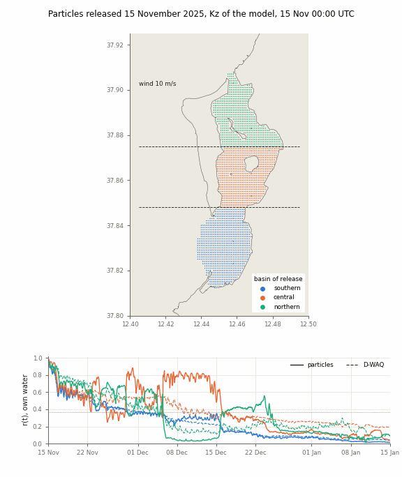
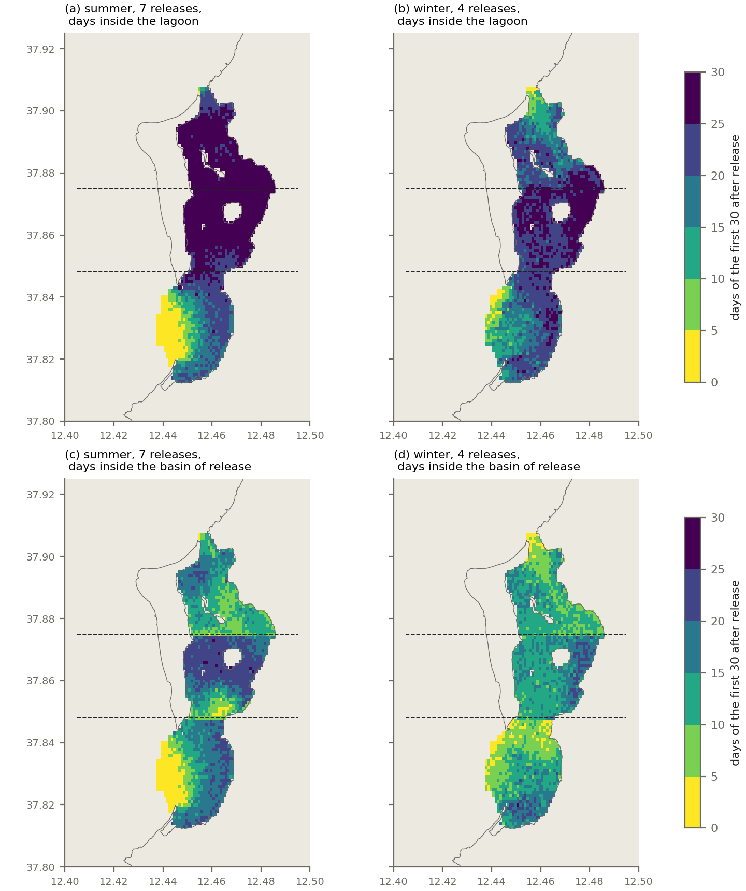

# Seasonal renewal of the Stagnone lagoon, summer and winter 2025

*Forcing prepared by `scripts/download_forcing_renewal.py` and `scripts/build_forcing_renewal.py`, cases built by `scripts/setup_renewal_season_simit.sh`, D-Water Quality releases written and run by `scripts/postrun_renewal_case_simit.sh releases` through `scripts/build_renewal_waq.py`, read by `scripts/renewal_waq_member.py`, currents for the particles extracted by `scripts/postrun_renewal_case_simit.sh fm` through `scripts/extract_lagoon_currents_3d.py`, particles run by `scripts/renewal_lagoon_opendrift.py`, and drawn by `scripts/figure_lagoon_renewal_seasonal.py`. The forcing, setup and figure scripts take the season `summer` or `winter` as argument, and the post-run script the case through `RENEWAL_CASE`. Lagoon mask, basins and measures of renewal in `scripts/renewal_common.py`. The cases and their outputs lie under `/storage/ciceromartinsjr/StagnoneDT/renewal/` on simit-server and the remaining fractions under `outputs/renewal/<case>/` locally, regenerated by the scripts and not versioned.*

The Stagnone di Marsala is a shallow lagoon of about 22 km² on the western coast of Sicily, closed to the west by the island of Isola Lunga and connected to the sea by a northern and a southern mouth. Its water renews by the exchange through the two mouths, which the meadows of *Posidonia oceanica* and *Cymodocea nodosa* covering most of its bed slow down. The time the water takes to renew bears on the hypersalinity of the lagoon in summer and enters RQ4 of [research_questions_status.md](research_questions_status.md), which asks how the decline of the seagrass cover has changed it. The computation reported here gives the time scales of renewal of the lagoon and of its three basins under the present cover, over a summer and a winter run of two to three months, by conservative tracers released every ten days in D-Water Quality (D-WAQ) on the hydrodynamics of D-Flow FM, so that the time scales are measured within the window and the spread between releases shows their dependence on the wind.

## Summary

The lagoon of 22 to 26 hm³ is divided by latitude into a southern, a central and a northern basin (Section 2). The fraction of the lagoon water still inside the lagoon falls below 1/e after 31 to 44 days in the nine of the eleven releases whose window is long enough, and the renewal time integrated over the window and extended by a fitted exponential lies between 34 and 45 days in both seasons (Section 5). The southern basin, which exchanges directly with the sea, renews its own water in about two weeks, the northern basin in about three weeks and the central basin in four, since it receives the water of the northern basin. The lagoon as a whole renews more slowly than any of its basins, since most of its water crosses the three basins before it leaves through a mouth, and the fitted exponentials place its 95 per cent renewal at 111 to 143 days. The fraction remaining after 30 days varies between releases only from 0.38 to 0.49. Wind toward the south, which adds to the north-to-south throughflow of the lagoon, shortens the renewal, as under the northerly to north-westerly wind of 26 to 31 July, when the lagoon lost 40 per cent of its water within ten days, and wind toward the north lengthens it (Section 6). The four tracers of D-WAQ depart from a sum of 1 inside the lagoon by up to 9 per cent after three months, which bounds the uncertainty of the remaining fractions (Section 7). Particles released on the same dates in OpenDrift follow the same pathway from the northern basin through the central basin to the southern mouth, and in summer keep 0.50 to 0.60 of the lagoon water after 30 days against 0.38 to 0.49 in D-WAQ, since the volume they carry is not conserved in the shallow lagoon (Section 8). The water held longest is that of the centre of the lagoon around and east of Mozia, which stays inside for most of the first 30 days in both seasons, while each mouth flushes its own reach within days to two weeks (Section 9).

## 1. Measures of renewal

A volume V₀ of water is marked inside a region at time t₀, the release. The remaining fraction r(t) is the part of V₀ found inside the same region at time t, which starts at 1 and falls as the marked water leaves and is replaced by water from outside the region. Water that leaves and returns counts again on return, so r(t) need not decrease monotonically. For a well-mixed region exchanging with an unlimited reservoir at a constant rate, r(t) = exp(−t/τ), and τ is the ratio of the volume of the region to the exchange flow. In that case r falls to 1/e ≈ 0.37 at t = τ, when 63 per cent of the water has been replaced, to 0.05 at about 3τ and to 0.01 at about 4.6τ. A real basin departs from the exponential, since the water nearest the mouths leaves first and the water of the interior later, and the following measures are taken from the computed r(t).

1. The e-folding time τ, at which r(t) first falls below 1/e. It is measured when the window of the release reaches it and is otherwise left open.
2. The renewal time θ = ∫₀^∞ r(t) dt of Takeoka (1984), the mean time a marked parcel spends inside the region before it leaves for good, which equals τ for the exponential. Over a window W the integral is truncated at W and is a lower bound on θ.
3. The exponential r = A exp(−t/τ_fit) fitted to ln r by least squares after the first day, which leaves out the initial exchange of the water nearest the mouths. It extends the truncated integral to θ_W + r(W) τ_fit, called the extended renewal time, and gives the times t₉₅ and t₉₉ at which r = 0.05 and 0.01 as τ_fit ln(A/r). Both extrapolate the rate of the later part of the window beyond it.

The measures apply to the lagoon as a whole and to each basin, with a difference in meaning. For a basin, the marked water is the water of that basin only, and it counts as replaced once it has left the basin, whether it has reached the sea or another basin of the lagoon. For the lagoon, the marked water is that of all three basins, and it counts as replaced only once it has left the lagoon through a mouth. Water that moves from the northern to the central basin therefore renews the northern basin without renewing the lagoon, and the lagoon renews more slowly than each of its basins when its water passes from one basin to the next on its way out.

## 2. Lagoon and basins

A face of the mesh belongs to the lagoon when the nearest sample of `lagoon_tracer_init.xyz` lies within 150 m and carries the value 1, the samples marking the faces inside the lagoon and the southern mouth up to the meridian of 12.4395 E and the northern mouth up to the head of its channel. The basins are separated at 37.848 N and 37.875 N, which places the southern mouth in the southern basin, the island of Mozia in the central basin and the northern mouth in the northern basin. The division at 37.848 N lies at the narrowing of the lagoon between the central and southern basins, about 1.4 km wide, and the division at 37.875 N lies just north of Mozia, where the lagoon is about 3 km wide, so that the boundary between the central and northern basins is a convention of this study and not a constriction of the water body.

*Bed depth of the domain clipped at 60 m, with the open boundary in red and the box of the currents given to the particles dashed (a). Mesh of the lagoon, its faces shaded by basin, the two latitudes that divide the basins dashed, and the volume of each basin at 1 July 2025 (b). Stem density of the canopy in the `[veg]` module, with the same divisions (c). The faces are those of the mesh on which D-WAQ computes.*

| Basin | Faces of the mesh | Volume at the summer releases (hm³) | Volume at the winter releases (hm³) |
|---|---|---|---|
| Southern | 1268 | 11.3 to 13.1 | 10.6 to 13.0 |
| Central | 1513 | 6.4 to 7.5 | 5.4 to 7.6 |
| Northern | 1462 | 4.4 to 5.6 | 3.6 to 5.6 |
| Lagoon | 4243 | 22.1 to 25.9 | 19.6 to 26.0 |

*The volume of each basin at 00:00 UTC of the release dates varies with the tide and with the setup of the sea level by the wind.*

## 3. Hydrodynamic cases

| Element | Setting |
|---|---|
| Model | D-Flow FM 2026.01, three-dimensional, without wave coupling, with fixed bed |
| Mesh | 25 210 faces, refined to 15 m inside the lagoon and at its mouths and coarsening offshore to the islands of the Egadi archipelago |
| Vertical | 10 uniform sigma layers |
| Canopy | seagrass in the `[veg]` module of FM with the stem density of panel c and a canopy height of 0.40 m |
| Open boundary | one polyline along the southern (37.70 N), western (11.96 E) and northern (38.06 N) edges; water level as the sum of the CMEMS sea level and a per-node offset anchored at the Marettimo gauge ([marettimo_offset_anchor_2025.md](marettimo_offset_anchor_2025.md)), CMEMS current, salinity and temperature |
| Surface | wind of ERA5 blended with the record of the AltaVilaEst station on the eastern flank of the central basin, ERA5 pressure, Charnock coefficient |
| Initial condition | cold start with the whole domain, the lagoon included, at the CMEMS profiles of salinity and temperature of the first day |
| Relaxation | salinity and temperature relaxed toward the daily CMEMS fields at sea only, with the rate `nudgerate` at 0.1 d⁻¹ outside the lagoon and 0 inside |
| Output for D-WAQ | hydrodynamics every 30 minutes, joined from the 8 partitions by `waqmerge` |

| Element | Summer | Winter |
|---|---|---|
| Case | `veg_summer_0608_0915` | `veg_winter_1108_0115` |
| Window | 8 June to 15 September 2025 | 8 November 2025 to 15 January 2026 |
| Forcing prepared | 7 June to 17 September | 7 November to 17 January |
| Surface freshwater flux | ERA5 evaporation (`mer`) | ERA5 evaporation and total precipitation (`mer` plus `mtpr`) |
| Run on simit-server, 8 cores | 8.7 h | 6.3 h |
| Releases | 7, from 15 June to 14 August | 4, from 15 November to 15 December |

The relaxation is confined to the sea so that the salinity of the lagoon follows its own exchange and evaporation, and the week between the start of each case and its first release lets the circulation adjust to the cold start. The precipitation over the summer window is 24 mm at the centre of the lagoon against an evaporation of 155 mm, a ratio of 0.16, most of it falling in September, and the summer run carries the evaporation alone. Over the winter window the precipitation of 212 mm exceeds the evaporation of 149 mm, and the winter run carries both.

Over the summer the surface salinity at the centre of the lagoon (C1 Central) rises from 37.5 to 42.7, and that at the southern centre (C3) to 41.9, while at the northern mouth (BocaNord) it stays near 38.0 and at the southern mouth (BocaSud) it reaches 39.7.

| Station | 8 June | 23 June | 8 July | 23 July | 7 August | 22 August | 6 September |
|---|---|---|---|---|---|---|---|
| BocaNord | 37.4 | 37.5 | 37.7 | 37.7 | 37.8 | 38.1 | 38.0 |
| C2 North Center | 37.5 | 38.1 | 38.6 | 39.0 | 38.4 | 39.3 | 39.5 |
| C1 Central | 37.5 | 38.4 | 39.7 | 40.9 | 41.3 | 41.9 | 42.7 |
| AltaVilaEst | 37.5 | 38.2 | 38.7 | 39.1 | 38.8 | 39.9 | 40.5 |
| C3 South Center | 37.5 | 38.2 | 39.3 | 40.5 | 41.2 | 41.3 | 41.9 |
| BocaSud | 37.4 | 37.8 | 38.1 | 38.3 | 38.6 | 39.0 | 39.7 |

## 4. Releases in D-WAQ

The hydrodynamics of each case, joined by `waqmerge`, gives D-WAQ the volumes, flows, exchange areas and vertical diffusivities of 252 100 segments in 10 layers every 30 minutes. Four conservative tracers are carried on it, one for the water of each basin, at 1 in its basin and 0 elsewhere at the release, and one for the sea, at 1 outside the lagoon at the release and on the open boundary throughout. The four sum to 1 in every segment for a transport that is linear and conservative, which serves as a check (Section 7). The mass of a tracer in a region is its concentration times the segment volume summed over the segments of the region, and the remaining fraction of a basin is the mass of its own tracer still inside it divided by the mass at the release, that of the lagoon the mass of the three basin tracers anywhere in the lagoon divided by their initial mass.

Each release is a separate D-WAQ run from the release date at 00:00 UTC to the end of the case, with the flux-corrected scheme 24 and the map output written every hour. The windows of the releases shorten from 92 to 32 days in summer and from 61 to 31 days in winter, so the fraction remaining after 30 days is the measure common to all releases. The runs are independent and ran in parallel on one core each of simit-server, the seven summer releases in 1.0 to 2.3 h and the four winter releases in 0.5 to 0.9 h.

## 5. Remaining fraction and time scales

| Release | Window (d) | r after 30 d | r at the end | τ (d) | θ truncated (d) | τ_fit (d) | θ extended (d) | t₉₅ (d) |
|---|---|---|---|---|---|---|---|---|
| 15 June | 92 | 0.44 | 0.11 | 38.5 | 33.8 | 43 | 38.5 | 124 |
| 25 June | 82 | 0.49 | 0.15 | 36.1 | 33.6 | 44 | 40.1 | 128 |
| 5 July | 72 | 0.41 | 0.18 | 33.4 | 31.1 | 44 | 38.8 | 125 |
| 15 July | 62 | 0.41 | 0.22 | 36.5 | 28.3 | 45 | 38.1 | 126 |
| 25 July | 52 | 0.38 | 0.24 | 31.1 | 23.0 | 47 | 34.5 | 126 |
| 4 August | 42 | 0.48 | 0.37 | 41.2 | 24.4 | 51 | 42.9 | 143 |
| 14 August | 32 | 0.47 | 0.45 | not reached | 21.1 | 42 | 40.0 | 124 |
| 15 November | 61 | 0.49 | 0.25 | 43.8 | 33.6 | 45 | 44.9 | 135 |
| 25 November | 51 | 0.41 | 0.24 | 32.9 | 26.0 | 38 | 35.1 | 111 |
| 5 December | 41 | 0.43 | 0.30 | 34.8 | 21.7 | 44 | 34.8 | 121 |
| 15 December | 31 | 0.45 | 0.45 | not reached | 21.2 | 45 | 41.7 | 133 |

*Lagoon as a whole, by D-WAQ with scheme 24.*

| Release | Southern τ (d) | Central τ (d) | Northern τ (d) | Southern θ extended (d) | Central θ extended (d) | Northern θ extended (d) |
|---|---|---|---|---|---|---|
| 15 June | 13.5 | 24.4 | 12.6 | 13.5 | 27.5 | 21.3 |
| 25 June | 14.3 | 19.7 | 14.4 | 13.5 | 28.4 | 21.4 |
| 5 July | 12.0 | 24.7 | 17.5 | 12.8 | 28.3 | 21.4 |
| 15 July | 12.2 | 20.4 | 14.7 | 11.5 | 28.6 | 20.8 |
| 25 July | 5.1 | 10.4 | 9.4 | 8.1 | 20.3 | 18.4 |
| 4 August | 12.6 | 21.6 | 12.3 | 13.2 | 28.7 | 21.4 |
| 14 August | 14.3 | 22.5 | 18.2 | 14.8 | 27.3 | 19.0 |
| 15 November | 15.9 | 24.1 | 19.0 | 15.9 | 32.3 | 22.8 |
| 25 November | 12.0 | 12.1 | 11.0 | 13.6 | 22.2 | 22.3 |
| 5 December | 9.8 | 4.2 | 9.0 | 10.7 | 22.6 | 22.6 |
| 15 December | 7.4 | 21.4 | 12.9 | 13.1 | 33.7 | 15.3 |

*Own water of each basin. The e-folding time of the central and northern basins in winter is reached in tidal oscillations of r, so the extended renewal time is the steadier measure.*

*Summer. Daily mean wind at 10 m over the centre of the lagoon, with arrows toward which it blows and the release dates in the colours of panels b to e (a). Remaining fraction of the lagoon (b) and of the own water of the southern, central and northern basins (c to e) by D-WAQ with scheme 24, against the days since release. The dotted line marks 1/e.*

*Winter, as in the summer figure.*

*Water of each basin in the column by D-WAQ with scheme 24 for the release of 15 June 2025, every 12 hours to 15 September (top). A face takes the colour of the basin whose tracer dominates the column, faded to white with the share of sea water, and the arrow gives the direction toward which the wind over the lagoon blows. Remaining fraction of the lagoon and of the own water of each basin, with the instant of the frame (bottom).*

*Release of 15 November 2025, every 12 hours to 15 January 2026, as in the summer animation.*

In the animations the water of the northern basin fills the central basin within three to four weeks, while the water of the central basin moves into the southern basin and the sea water entering through the southern mouth replaces the southern water first along the western side of the basin. The northern basin is refilled from the northern mouth, its colour fading toward white from the mouth eastward.

The lagoon reaches 1/e after 31 to 44 days in every release whose window is long enough, and the extended renewal time stays within 34 to 45 days across both seasons. The decay is fastest in the first two weeks, when the water near the mouths leaves, and slower afterwards, so an exponential fitted to the first days underestimates the later time scales, and the e-folding times of the fits over two to three months, 38 to 51 days, exceed the measured τ.

The southern basin, which exchanges directly with the sea through the southern mouth, renews in about two weeks in both seasons. The central basin keeps its water longest, with extended renewal times of 27 to 29 days in summer outside the event of late July, since the water that leaves it is replaced by the water of the northern basin. The northern basin loses its own water in about three weeks, with r oscillating at the tidal period around a falling trend.

The lagoon renews more slowly than each basin for the reason given in Section 1. Its 95 per cent renewal at 111 to 143 days is about three times its e-folding time, as for an exponential, and its e-folding time exceeds that of every basin, since the water of the northern and central basins counts as renewed for its basin once it moves south but stays lagoon water until it leaves through the southern mouth. A time of two to four weeks for each basin and of four months for 95 per cent of the lagoon are therefore consistent measures of the same circulation.

## 6. Dependence on the wind

| Release | Mean wind speed, first 14 days (m/s) | Mean wind from the north, first 14 days (m/s) | r after 30 days |
|---|---|---|---|
| 15 June | 3.4 | 2.4 | 0.44 |
| 25 June | 3.6 | 2.1 | 0.49 |
| 5 July | 4.6 | 1.4 | 0.41 |
| 15 July | 5.3 | 0.7 | 0.41 |
| 25 July | 5.4 | 2.3 | 0.38 |
| 4 August | 3.7 | 3.1 | 0.48 |
| 14 August | 3.7 | 0.1 | 0.47 |
| 15 November | 5.4 | −1.6 | 0.49 |
| 25 November | 4.5 | 0.5 | 0.41 |
| 5 December | 4.2 | −0.7 | 0.43 |
| 15 December | 4.5 | −2.8 | 0.45 |

*Blended wind at 10 m at the centre of the lagoon (12.46 E, 37.86 N), averaged over the first 14 days after each release. The component from the north is positive for wind blowing toward the south.*

In summer the remaining fraction after 30 days falls as the mean wind of the first two weeks strengthens, from 0.44 to 0.49 under 3.4 to 3.7 m/s to 0.38 to 0.41 under 4.6 to 5.4 m/s. The release of 25 July shows the effect of a single event, since the northerly to north-westerly wind of 26 to 31 July, with daily means up to 10 m/s, took 40 per cent of the lagoon water within ten days and brought the e-folding times of the southern and central basins to less than half of those of the other summer releases, and that of the northern basin to about two thirds. The release of 15 July met the same event 11 to 16 days after release, which shows as a step of its curve, and its remaining fraction after 30 days, 0.41, approaches that of 25 July. Outside these events the curves of the summer releases nearly coincide.

In winter the wind is stronger on average but alternates between southerly to south-westerly and north-westerly directions, and the renewal is not faster than in summer. The release of 15 November, under the strongest mean wind of the winter but from the south, keeps the largest fraction after 30 days, 0.49, with a nearly flat r over its first eight days, while the release of 25 November, under weaker wind with a northerly component, keeps 0.41. The lagoon carries a slow throughflow from the northern to the southern mouth, set by a sea-level difference of a few centimetres between the two mouths along the coast. Wind toward the south adds to it and wind toward the north opposes it, so the direction of the wind matters as much as its speed. Eleven releases do not allow a regression on speed and direction, and the dependence is stated here as the ordering of the releases.

## 7. Conservation of the tracers

Inside the lagoon, the sum of the four tracers weighted by segment volume rises steadily over the summer release of 15 June, to 1.03 after 20 days, 1.06 after 40 days and 1.09 after 90 days, with a 99th percentile of 1.13 at the end. Over the winter release of 5 December it stays within 1.00 to 1.02 for 35 days and reaches 1.06 on the last day. The largest departure in a single segment, 17 to 193, lies in sea faces of a few cubic metres that dry and wet again, whose mass is negligible.

A loss of water by evaporation that the volumes carry and the flows do not would raise the concentrations in the same way, but the winter window, with a net gain of freshwater of 41 mm after 5 December, shows a rise of the sum as well, so the drift is not attributed to the surface freshwater flux. The flux limiter of scheme 24, which acts on each tracer separately and is not linear, is a candidate. A run with a single tracer uniform at 1 over the domain and on the boundary, on which the limiter does not act, would separate the transport scheme from an imbalance between volumes and flows. The remaining fractions are computed from the mass of the tracers and carry an uncertainty of the order of the drift, a few per cent over the first month and up to 9 per cent after three months, without change to the time scales at the precision of the tables.

## 8. Particles

The same eleven releases are followed by particles advected offline by OpenDrift (Dagestad et al., 2018) with the model OceanDrift in the currents of each case. The horizontal currents and the vertical eddy diffusivity of the map output, the diffusivity taken as the eddy viscosity divided by the turbulent Prandtl-Schmidt number 0.7 of FM, are interpolated every 30 minutes onto a grid of about 50 m in the box 12.38 to 12.50 E and 37.79 to 37.93 N, which holds the lagoon and some 4 km of the sea west and north of it, and onto 12 depths below the free surface (`extract_lagoon_currents_3d.py`). At each release the particles fill the water column of the three basins at every second grid point, about 100 m apart, three per column at the centres of equal parts of the column, each standing for the volume of its part, so that r(t) is a fraction of the volume of the basin. They are advected with a fourth-order Runge-Kutta step of 300 s, mixed vertically by a random walk with the eddy diffusivity of the model, and carried without vertical advection and without drift by the wind (`renewal_lagoon_opendrift.py`). A particle that leaves the box is counted as renewed. Each release ran on one core of simit-server in up to 1.5 h.

| Release | r after 30 d, particles | r after 30 d, D-WAQ | θ extended (d), particles | θ extended (d), D-WAQ |
|---|---|---|---|---|
| 15 June | 0.55 | 0.44 | 60 | 38.5 |
| 25 June | 0.60 | 0.49 | 63 | 40.1 |
| 5 July | 0.51 | 0.41 | 59 | 38.8 |
| 15 July | 0.50 | 0.41 | 57 | 38.1 |
| 25 July | 0.50 | 0.38 | 47 | 34.5 |
| 4 August | 0.54 | 0.48 | 57 | 42.9 |
| 14 August | 0.52 | 0.47 | 46 | 40.0 |
| 15 November | 0.67 | 0.49 | 38 | 44.9 |
| 25 November | 0.40 | 0.41 | 31 | 35.1 |
| 5 December | 0.36 | 0.43 | 28 | 34.8 |
| 15 December | 0.52 | 0.45 | 38 | 41.7 |

*Lagoon as a whole, by the particles under the eddy diffusivity of the model and by D-WAQ with scheme 24.*

*Positions of the particles released on 15 June 2025, every 12 hours to 15 September, coloured by basin of release, with the arrow of the wind over the lagoon toward which it blows (top). Remaining fraction of the own water of each basin by the particles (solid) and by D-WAQ (dashed), with the instant of the frame (bottom). The dotted line marks 1/e.*

*Particles released on 15 November 2025, every 12 hours to 15 January 2026, as in the summer animation.*

In both seasons the particles of the northern basin move south into the central basin, those of the central basin into the southern basin, and those of the southern basin leave through the southern mouth and the shallows west of it, the pathway of the Eulerian reading. In summer the particles keep more of the lagoon water than D-WAQ in every release, 0.50 to 0.60 against 0.38 to 0.49 after 30 days, with the largest differences in the central basin, and their extended renewal times of 46 to 63 days exceed those of D-WAQ by 6 to 23 days. In winter the two readings differ in either direction, and the particles of 15 November, released under southerly wind, keep 0.67 of the lagoon water after 30 days against 0.49 in D-WAQ.

The remaining fractions of the particles change in steps, where the cloud of a basin crosses a division between basins or a mouth within hours under a change of wind and returns with the next reversal, while in D-WAQ the tracers mix across the same divisions and change smoothly. The velocity interpolated onto fixed depths in a basin of 0.5 to 1.5 m with sigma layers of 5 to 15 cm is not divergence free, so the particles gather where the interpolated field converges and the volume they carry is not conserved, whereas D-WAQ transports the tracers on the fluxes of FM, which close the volume balance. The particles are therefore used for the pathways between the basins, shown in the animations, and D-WAQ for the remaining fractions and time scales of Sections 5 and 6.

## 9. Retention by position

The particles released at the same seeded columns in every release give, for each column, the time its water spends inside the lagoon and inside its basin of release. The time is counted over the first 30 days after release, the window common to all releases, averaged over the three particles of the column with their volumes as weights and then over the seven summer and the four winter releases.

*Days of the first 30 after release that the particles of each seeded column spend inside the lagoon (a, b) and inside their basin of release (c, d), averaged over the seven summer releases (a, c) and the four winter releases (b, d), under the eddy diffusivity of the model, in classes of 5 days. The dashed lines divide the basins.*

| Basin of release | Inside the lagoon, summer (d) | Inside the lagoon, winter (d) | Inside the basin, summer (d) | Inside the basin, winter (d) |
|---|---|---|---|---|
| Southern | 17.3 (1.5 to 23.4) | 18.9 (9.7 to 24.4) | 15.3 (1.3 to 20.3) | 11.1 (5.2 to 18.3) |
| Central | 28.2 (24.9 to 29.2) | 25.1 (22.0 to 28.0) | 20.4 (9.6 to 23.3) | 14.5 (11.5 to 19.4) |
| Northern | 27.0 (24.8 to 28.8) | 20.7 (12.3 to 25.9) | 12.6 (8.1 to 19.0) | 11.5 (7.0 to 15.5) |

*Median over the seeded columns of each basin, with the 10th and 90th percentiles in parentheses, of the days of the first 30 after release.*

The water held longest in the lagoon is that of the central basin around and east of Mozia and of the southern part of the northern basin, which in summer stays inside for 27 to 30 of the 30 days and in winter for 22 to 29. This water leaves only by crossing the southern basin to the southern mouth, the longest path to the sea in the lagoon. The western half of the southern basin, between the southern mouth and the shallows west of it, renews within days in summer, and in winter the water near the northern mouth leaves within one to two weeks, so that each mouth flushes its own reach while the centre of the lagoon is renewed last. Inside the basin of release (panels c and d), the water of the central basin north and west of Mozia stays longest, about 20 days in summer, while its southern reach at the narrowing passes into the southern basin within days, and the eastern part of the northern basin passes into the central basin within one to two weeks.

The retention in winter is shorter than in summer in the northern basin, by six days in the median, and changes little in the central basin. The southerly to south-westerly winds of the winter window oppose the north-to-south throughflow (Section 6) and push the water of the northern basin toward the northern mouth, consistent with its faster loss in winter. The particles keep more lagoon water than D-WAQ in summer (Section 8), so the summer days of panel a are upper values, and the pattern of the map, rather than its absolute days, is the result. The area of longest retention east of Mozia coincides with the highest salinity of the summer run at the centre of the lagoon (Section 3) and with the area where Mancuso et al. (2023) measured the highest salinity in July 2017.

## 10. Relation to the nine-day case of July 2025

A first renewal case under the same member, from a stratified start on 1 to 10 July 2025, is reported in [lagoon_renewal.md](lagoon_renewal.md) with the online tracer of FM, particles in OpenDrift and D-WAQ. Its window ended before the lagoon reached 1/e, and an exponential fitted to its nine days gave e-folding times of 26 to 32 days by the Eulerian readings and a 95 per cent renewal at 70 to 95 days. The seasonal releases measure τ at 31 to 44 days and place t₉₅ at 111 to 143 days, since the fit over nine days follows the fast early decay alone. The order of renewal of the basins, the northern basin passing its water to the central basin and the southern basin exporting to the sea, and the role of northerly wind events agree between the two computations.

## 11. Matters open

1. The drift of the summed tracers (Section 7) is to be traced by a D-WAQ run with a uniform tracer, and the fraction of the drift carried by the basin tracers rather than by the sea tracer is to be computed, since only the former biases r.
2. The flushing time and the mixing efficiency of Umgiesser et al. (2014) require the outflow at the mouths over each window, which the throughflow diagnostic `diagnose_lagoon_throughflow.py` gives for the seasonal cases.
3. The gradient of salinity of the summer run, highest at the centre of the lagoon and near the sea at both mouths (Section 3), is to be compared with the July survey of Mancuso et al. (2023), which found the highest salinity east of Mozia. The Atoll point of that survey is not among the stations of the model and is to be read from the map output.
4. The summer run carries no precipitation, a choice that affects mainly September, after the releases.
5. RQ4 requires the summer run and its releases under the cover of 2003 and under further loss of cover.

## References

Dagestad, K.-F., Röhrs, J., Breivik, Ø. and Ådlandsvik, B. (2018). OpenDrift v1.0, a generic framework for trajectory modelling. *Geoscientific Model Development* 11, 1405–1420.

Mancuso, F.P. et al. (2023). Life on the edge: adaptations of *Posidonia oceanica* to hypersaline conditions in a Mediterranean lagoon system. *Environmental and Experimental Botany* 210, 105320.

Takeoka, H. (1984). Fundamental concepts of exchange and transport time scales in a coastal sea. *Continental Shelf Research* 3, 311–326.

Umgiesser, G., Ferrarin, C., Cucco, A., De Pascalis, F., Bellafiore, D., Ghezzo, M. and Bajo, M. (2014). Comparative hydrodynamics of 10 Mediterranean lagoons by means of numerical modeling. *Journal of Geophysical Research: Oceans* 119, 2212–2226.
