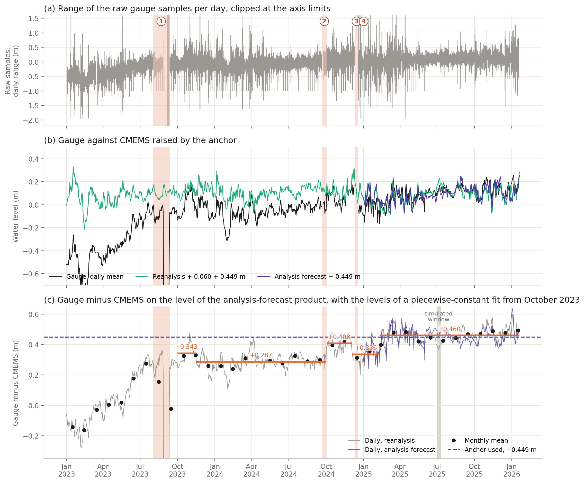
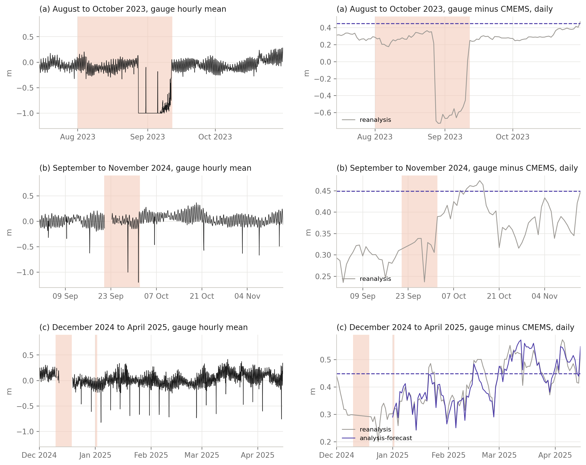

# Marettimo gauge record 2023–2026 and the anchor of the boundary offset

The water-level boundary of every ensemble member carries a per-node offset
anchored on the Marettimo tide gauge (JRC TAD 658), +0.449 m, the mean of gauge
minus CMEMS analysis-forecast sea surface height over 384 days from 1 January
2025 to 19 January 2026 ([`marettimo_offset_anchor_2025.md`](marettimo_offset_anchor_2025.md)).
The monthly means of that difference were lower in January and February 2025,
+0.361 and +0.371 m, than in the rest of the year. The gauge record was
extended back to January 2023 to establish whether that departure recurs or
belongs to a change of level of the gauge.

## Data

| Series | Source | Span | Note |
|---|---|---|---|
| Gauge | JRC TAD 658, `download_marettimo_wl_long.py` | 1 Jan 2023 to 19 Jan 2026 | 15 s sampling to December 2024, 90 s from January 2025; no record after 19 January 2026 |
| Analysis-forecast | `cmems_mod_med_phy-ssh_anfc_4.2km_P1D-m` | from 1 Nov 2024 | the product of the anchor and of the boundary forcing |
| Reanalysis | `cmems_mod_med_phy-ssh_my_4.2km_P1D-m` | 1987 to Oct 2026 | rest state differs from the analysis-forecast |

The reanalysis is raised by +0.060 m, the mean difference between the two
products over the 385 days on which both exist (standard deviation 0.041 m),
so that gauge minus reanalysis sits on the level of the anchor. Daily gauge
means require at least 18 h of record. Days departing from a 15-day running
median by more than 0.3 m are spikes of the raw stream and are omitted from
the differences. Scripts `analyse_marettimo_anchor_long.py` and
`plot_marettimo_gauge_record.py`.

## Record

*(a) Daily range of the raw samples. (b) Daily gauge mean against the two
CMEMS products raised by the anchor. (c) Gauge minus CMEMS, daily and monthly,
with the levels of a piecewise-constant fit from October 2023 and the anchor
used. Shaded and numbered: 1, sensor held at −1.000 m in August and September
2023; 2, gap of 54 h ending 23 September 2024 and a spike to +8 m on
1 October 2024; 3, gaps of 9 to 178 h in December 2024; 4, change of sampling
from 15 to 90 s at the start of 2025.*

*The three breaks, gauge hourly mean on the left and gauge minus CMEMS on the
right.*

The record contains four regimes.

| Period | Gauge minus CMEMS | Behaviour of the gauge |
|---|---|---|
| January to July 2023 | rises from about −0.15 to +0.30 m | monthly gauge mean rises from −0.44 (January) and −0.64 m (February) to −0.09 m (July) while the reanalysis stays between −0.36 and −0.54 m |
| August to mid-September 2023 | not usable | samples held at −1.000 m, recovery over 11 and 12 September |
| October 2023 to 1 October 2024 | +0.29 m (+0.34 m to mid-November 2023) | steady |
| 2 October 2024 to 10 February 2025 | +0.41 m, then +0.34 m from December | step of +0.08 m within one day after the spike of 1 October |
| 11 February 2025 to 19 January 2026 | +0.460 m, trend +0.036 m per year | steady after a transition of about three weeks |

The rise of the first half of 2023 has no counterpart in either product and
reads as drift of the sensor. The step of 2 October 2024 follows a 54 h gap and
a spike to +8 m on 1 October, the signature of an intervention on the
instrument. The rise of February 2025 is the largest change in the
piecewise-constant fit, with a gain in explained variance about seven times
that of the next, but it occurs over about three weeks, between mid-February
and early March, with no gap or spike in the gauge, so the record does not
show whether it is a change of the instrument or a departure of both CMEMS
products from the sea level at the island. The change of sampling at the turn
of the year shows that the logger was reconfigured in that period. No
maintenance log or levelling of the gauge datum is available to date these
changes independently, and the request to ISPRA for the datum of the station
remains open.

The 0.11 m per year previously reported for October 2023 to January 2026 is a
straight line fitted across these levels, not a drift of that size. Within the
last regime the trend is +0.036 m per year.

## Anchor over alternative periods

All values are gauge minus analysis-forecast, the product of the boundary
forcing.

| Period | Days | Mean (m) | Against the anchor used |
|---|---|---|---|
| 1 Jan 2025 to 19 Jan 2026, used | 384 | +0.449 | |
| 11 Feb 2025 to 19 Jan 2026, last regime | 343 | +0.461 | +0.012 |
| 1 Mar 2025 to 19 Jan 2026 | 325 | +0.464 | +0.015 |
| 1 to 10 Jul 2025, simulated window | 10 | +0.469 | +0.020 |

A period from March 2025 to March 2026 is not available, since the gauge has
no record after 19 January 2026, and the nearest equivalent, March 2025 to the
end of the record, gives +0.464 m.

## Reading

January and February 2025 belong mainly to the level that preceded the change
of February 2025. A winter component may contribute a few centimetres, since
the same months of 2024 lie 0.03 and 0.05 m below the +0.287 m of their own
regime, against 0.09 m below the anchor in 2025. An anchor confined to the regime that contains the
simulation, from 11 February or 1 March 2025, is better founded than one that
spans the change, and it would raise the boundary level by 0.012 to 0.015 m.
Such a change is within the residual of about 0.07 m that a constant anchor
leaves, and it would add to the positive raw bias of the members at the North
Mouth and AltaVilaEst, +0.03 to +0.09 m, while leaving anomaly RMSE and
correlation unchanged to first order. Its effect on drifter skill has not been
tested.
