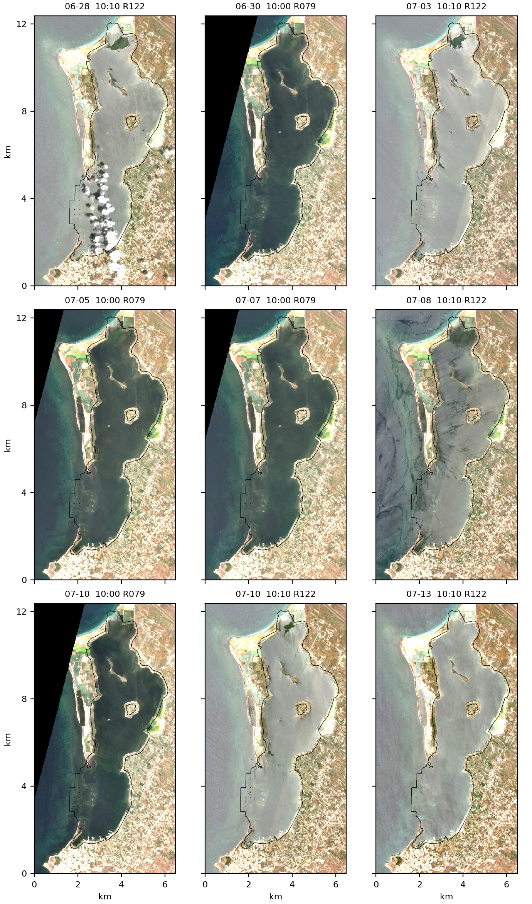
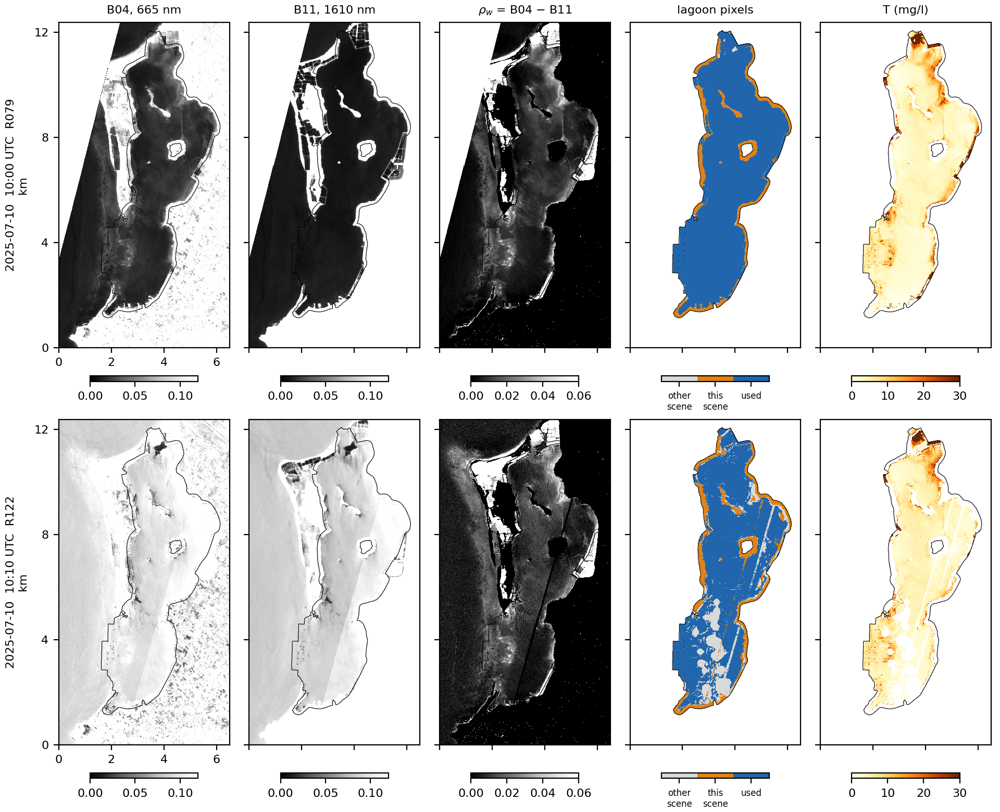
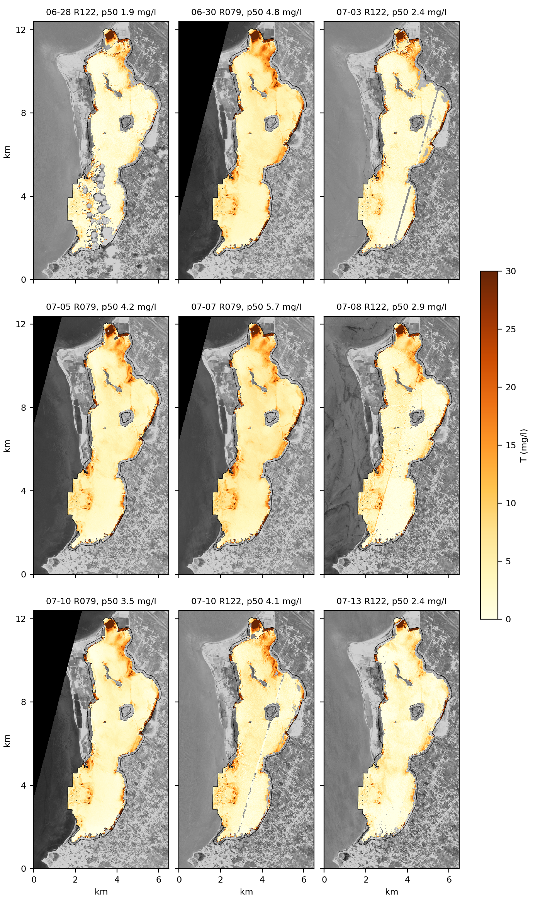
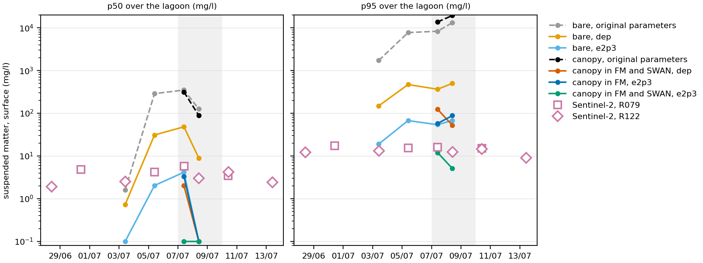

# Suspended matter in the Stagnone lagoon from Sentinel-2, 28 June to 13 July 2025

*Retrieval by `scripts/s2_suspended_matter_lagoon.py`, surface silt of the model members at the overpasses by `scripts/surface_silt_at_s2_overpasses_simit.py` on simit-server, figures by `scripts/figure_s2_suspended_matter.py`. Lagoon mask from `scripts/renewal_common.py`. Statistics per scene in `data/processed/s2_tsm_july2025.csv` and per member in `data/processed/arm_surface_silt_s2.csv`. The bands are cached under `data/raw/satellite/s2_cogs_july2025/`, regenerated by the retrieval script and not versioned.*

The wave-coupled members with a mobile bed of the eight-member factorial (wave coupling, canopy and mobile bed) resuspend silt over the lagoon at concentrations that the model alone cannot qualify. The plausibility target adopted for the sediment parameters, a lagoon silt concentration between 1 and 20 mg/l with events up to about 50 mg/l, was set for calm conditions, and the window of the drifter deployments, 7 to 10 July 2025, is the most energetic of the run, with a median of the maximum bed shear stress over the lagoon of 0.43 N/m² against 0.08 N/m² on 2 to 4 July in the bare wave-coupled member with unrestricted deposition (Section 7). The Sentinel-2 scenes of the same weeks give an observed concentration of total suspended matter at the surface of the lagoon, independent of the model, against which the target and the members are set.

## Summary

Nine Sentinel-2 L2A scenes of tile 33STB between 28 June and 13 July 2025, from two relative orbits at 10:00 and 10:10 UTC, cover the lagoon with less than 8 % cloud over the tile (Section 1). Total suspended matter is retrieved by the single-band algorithm of Nechad et al. (2010) at 665 nm, applied to the bottom-of-atmosphere reflectance of band B04 less that of band B11 at 1610 nm, which removes sun glint and residual haze (Sections 2 to 4). Statistics are taken over the lagoon pixels valid in every scene of the same orbit (Section 5).

The median concentration over the lagoon lies between 1.9 and 5.7 mg/l and the 95th percentile between 9 and 18 mg/l in every scene, and the scenes of 7 to 10 July exceed the earlier scenes of the same orbit by at most about 2 mg/l (Section 6). The two overpasses of 10 July, ten minutes apart from different orbits, give medians of 3.5 and 4.2 mg/l and 95th percentiles of 15.1 and 14.6 mg/l. The bright bottom of a lagoon about 1 m deep adds to the red reflectance, so that the retrieved values bound the concentration from above.

In the surface layer of the model at the same instants from 5 July, the members with the original sediment parameters exceed the observed median by a factor of 30 to 70 and the observed 95th percentile by a factor of 500 to 1600 (Section 7). With unrestricted deposition and the tuned erosion parameters, or with the canopy also represented in SWAN, the median falls to 0 to 4 mg/l, at or below the observed values, while the 95th percentile of 52 to 124 mg/l remains three to eight times above the observation. The two changes together bring the 95th percentile to 12 and 5 mg/l on 7 and 8 July, at or below the observed 16 and 12 mg/l. The target of 1 to 20 mg/l holds under the energetic conditions of the window, and the departure lies in local concentrations of the model that the scenes do not show.

## 1. Scenes

The scenes are the Sentinel-2 L2A products of tile 33STB, processing baseline 05.11, read as cloud-optimised GeoTIFFs from the Earth Search catalogue of Element 84 on Amazon Web Services, which serves the products of the Copernicus programme without authentication. The atmospheric correction is that of Sen2Cor (Main-Knorn et al., 2017). The window of the bands read is the box 12.42 to 12.49 E, 37.80 to 37.91 N, about 6.2 by 12.2 km at 10 m.

| Date | Time (UTC) | Satellite | Relative orbit | Cloud over the tile (%) | Valid lagoon pixels |
|---|---|---|---|---|---|
| 28 June | 10:10 | Sentinel-2C | R122 | 2.6 | 192 816 |
| 30 June | 10:00 | Sentinel-2B | R079 | 0.0 | 223 542 |
| 3 July | 10:10 | Sentinel-2B | R122 | 1.6 | 211 817 |
| 5 July | 10:00 | Sentinel-2C | R079 | 0.2 | 222 911 |
| 7 July | 10:00 | Sentinel-2A | R079 | 1.1 | 223 145 |
| 8 July | 10:10 | Sentinel-2C | R122 | 7.8 | 221 521 |
| 10 July | 10:00 | Sentinel-2B | R079 | 1.2 | 222 693 |
| 10 July | 10:10 | Sentinel-2A | R122 | 1.3 | 215 977 |
| 13 July | 10:10 | Sentinel-2B | R122 | 0.4 | 217 613 |

The lagoon mask holds 249 494 pixels. The relative orbit is absent from the catalogue entries and is assigned from the time of the overpass. The swath of orbit R079 ends west of the lagoon, so that its scenes cover the lagoon and the island of Isola Lunga but not the open sea to the west.

*Bands B04, B03 and B02 as red, green and blue, reflectance stretched to 0.20 with a gamma of 1.6, and the lagoon mask outlined in black. Distances in km from the south-western corner of the window. The black wedge in the scenes of orbit R079 lies outside its swath. The scenes of orbit R122 appear brighter over the water because of sun glint (Section 3).*

## 2. Reflectance

The bands are stored as integers, and the bottom-of-atmosphere reflectance follows from

$$\rho_{BOA} = s \, DN + o, \qquad s = 10^{-4},$$

where the offset $o$ is $-0.1$ in the products of baseline 04.00 and later as distributed by the European Space Agency. Earth Search removes this offset before writing the files and marks the products with `earthsearch:boa_offset_applied = true`, while the asset metadata still list $o = -0.1$. The offset is therefore taken as zero. The urban land of Marsala at the southern end of the window gives a red digital number of 1534 to 1854 in the nine scenes, a reflectance of 0.15 to 0.19 with $o = 0$ and of 0.05 to 0.09 with $o = -0.1$. The first is the value expected of built surfaces in the red, and the second would place most lagoon pixels of orbit R079, with digital numbers of 200 to 300, at negative reflectance.

## 3. Sun glint and haze

Over the deep open sea west of Marsala, 12.30 to 12.36 E, the red reflectance of the scenes of orbit R122 is 0.065 to 0.084, against about 0.005 expected of clear oceanic water at 665 nm. The excess is specular reflection of the sun at the viewing geometry of that orbit, visible as the brighter tone of the water in the first figure, and it raises the lagoon in the red by a factor of three to four against orbit R079 on the same day. Water absorbs strongly at 1610 nm, where the water-leaving reflectance is negligible even in turbid water, the premise of the short-wave infrared atmospheric correction of Wang and Shi (2007). The reflectance of band B11 at 1610 nm therefore measures the glint and the residual haze over each pixel, which vary little with wavelength over this range (Kay et al., 2009). The water reflectance is taken as

$$\rho_w(665) = \rho_{BOA}(665) - \rho_{BOA}(1610),$$

with band B11 resampled from 20 m to the 10 m grid of band B04.

## 4. Suspended matter

Total suspended matter $T$ (g/m³, numerically mg/l) follows from the water reflectance by the semi-analytical algorithm of Nechad et al. (2010),

$$T = \frac{A \, \rho_w}{1 - \rho_w / C}, \qquad A = 355.85 \ \mathrm{g\,m^{-3}}, \quad C = 0.1728,$$

with the coefficients of the 665 nm band calibrated by Nechad et al. (2010) on in-situ measurements of the southern North Sea. The term in the denominator accounts for the saturation of the reflectance as backscattering by particles approaches absorption. The retrieval is used up to $\rho_w < 0.8\,C$, which corresponds to $T$ of about 246 mg/l, beyond which the denominator amplifies small errors of reflectance. Between 590 and 840 lagoon pixels per scene, 0.3 % of the mask, exceed this limit and are left out. Their number does not change between scenes, and they lie at the margins against the salt pans rather than in open water. Values of $\rho_w$ between $-0.01$ and 0 are taken as 0, since the subtraction of band B11 leaves noise of that order over clear water. Pixels below $-0.01$, between 2 and 9 % of the mask according to the scene and more frequent under glint, are left out. Their omission removes clear water and so raises the percentiles slightly.

## 5. Pixel selection

A pixel belongs to the lagoon when the nearest sample of `lagoon_tracer_init.xyz`, within 150 m, carries the value 1. This is the definition of the renewal computations ([lagoon_renewal.md](lagoon_renewal.md), Section 3), which closes the lagoon at the southern mouth by the meridian of 12.4395 E and at the northern mouth at the head of the channel, and it is applied unchanged to the faces of the model in Section 7. The distance of 150 m reaches part of the shore, which the scene classification of Sen2Cor removes.

| Scene classification | Classes | Treatment |
|---|---|---|
| No data, saturated or defective | 0, 1 | left out |
| Cloud shadow | 3 | left out |
| Vegetation, bare soil | 4, 5 | left out (shore within reach of the mask, about 21 000 pixels per scene) |
| Water, dark area, unclassified | 6, 2, 7 | kept |
| Cloud of medium and high probability, thin cirrus | 8, 9, 10 | left out |

The water class itself is not required, since Sen2Cor classes part of the shallow vegetated bottom of the lagoon as dark area or unclassified. Statistics are taken over the pixels valid in every scene of the same orbit, 221 313 pixels for orbit R079 (89 % of the mask) and 179 269 for orbit R122 (72 %), so that the scenes of one orbit are compared over the same water. The scenes of orbit R122 lose more pixels to the clouds and cloud shadows over the southern basin on 28 June, which the common set carries into the four later scenes of the orbit, to the seams between detectors that cross the lagoon as diagonal stripes on 3, 8 and 10 July, and to negative reflectance under glint. The median and the 95th percentile are also given over the pixels valid in each scene alone, between 192 816 and 223 542 pixels (77 to 90 % of the mask), and the maps of Section 6 show each scene with its own pixels.

*Red reflectance (B04), short-wave infrared reflectance (B11), water reflectance after the subtraction of B11, lagoon pixels left out in this scene, left out in another scene of the same orbit or used, and total suspended matter $T$ over the pixels used. Orbit R079 at 10:00 UTC in the upper row, orbit R122 at 10:10 UTC in the lower row. The glint of orbit R122 appears in both B04 and B11 and is absent from their difference.*

## 6. Results

| Date | Time (UTC) | Orbit | $\rho_w$ p50 | $T$ p25 | $T$ p50 | $T$ p75 | $T$ p95 | $T$ p50, scene | $T$ p95, scene |
|---|---|---|---|---|---|---|---|---|---|
| 28 June | 10:10 | R122 | 0.005 | 0.8 | 1.9 | 3.8 | 12.1 | 1.9 | 13.0 |
| 30 June | 10:00 | R079 | 0.012 | 3.6 | 4.8 | 6.8 | 17.3 | 4.8 | 17.6 |
| 3 July | 10:10 | R122 | 0.007 | 1.4 | 2.5 | 4.4 | 13.1 | 2.4 | 14.9 |
| 5 July | 10:00 | R079 | 0.011 | 3.0 | 4.2 | 6.1 | 15.5 | 4.2 | 15.7 |
| 7 July | 10:00 | R079 | 0.015 | 4.5 | 5.7 | 7.6 | 15.9 | 5.7 | 16.1 |
| 8 July | 10:10 | R122 | 0.008 | 1.3 | 3.0 | 5.3 | 12.4 | 2.9 | 14.4 |
| 10 July | 10:00 | R079 | 0.009 | 2.2 | 3.5 | 5.4 | 15.1 | 3.5 | 15.2 |
| 10 July | 10:10 | R122 | 0.011 | 2.7 | 4.2 | 6.1 | 14.6 | 4.1 | 16.4 |
| 13 July | 10:10 | R122 | 0.007 | 1.1 | 2.4 | 4.1 | 9.1 | 2.4 | 10.0 |

*Percentiles of $T$ in mg/l over the pixels common to the orbit, and in the last two columns over the pixels valid in the scene.*

The pixels left out of the common set but valid in the scene raise the 95th percentile by up to 2.0 mg/l in orbit R122 and by up to 0.4 mg/l in orbit R079, and change the median by no more than 0.1 mg/l, since they lie over the southern basin and the eastern shore, which are slightly more turbid than the lagoon as a whole. The two overpasses of 10 July agree within 0.8 mg/l in the median and the 95th percentile of the common pixels, although their masks of common pixels differ and the uncorrected red reflectance of orbit R122 is three to four times that of orbit R079. The agreement shows that the subtraction of band B11 removes the glint to within the spread between scenes. The median over the lagoon stays between 1.9 and 5.7 mg/l through the sixteen days and the 95th percentile between 9 and 18 mg/l. Within orbit R079 the medians of 5 and 7 July, 4.2 and 5.7 mg/l, bracket that of 30 June, 4.8 mg/l. Within orbit R122 the medians of 8 and 10 July exceed those of 28 June and 3 July by 0.5 to 2.3 mg/l and the 95th percentiles by 0.3 to 2.5 mg/l, and 13 July returns to the earlier level. The energetic window therefore raises the observed concentration by at most about 2 mg/l. The medians of orbit R079 exceed those of orbit R122 over the whole period, while on 10 July, the one day both orbits pass, orbit R122 reads 0.8 mg/l higher, so that the difference between the orbits follows the dates they sample.

The concentration is highest along the eastern shore of the lagoon, in the channel of the northern mouth and over the shallows west of the southern basin, and lowest over the central basin, a pattern that repeats in every scene.

*$T$ over the lagoon pixels valid in each scene, on the mean of the three visible bands in grey, with the median over those pixels in the title of each panel. The scenes run by date from left to right and from top to bottom.*

## 7. Comparison with the members

The model members are the wave-coupled members with a mobile bed of the factorial, with and without the canopy, under three sets of parameters of the silt fraction.

| Set | `TcrSed` (N/m²) | `TcrEro` (N/m²) | `EroPar` (kg/m²/s) |
|---|---|---|---|
| Original | 0.1 | 0.1 | 1 × 10⁻⁴ |
| dep | 1000 | 0.1 | 1 × 10⁻⁴ |
| e2p3 | 1000 | 0.2 | 3 × 10⁻⁵ |

A critical shear stress for sedimentation of 1000 N/m² lets deposition proceed at every stress. The bare members are cold starts on 1 July 2025 with the update of the bed level held through the first day (`MorStt` of 86 400 s), and the canopy members are segments from 7 to 10 July restarted from the state of their bare parent on 7 July. The canopy acts on the flow through the `[veg]` module of FM in every canopy member, and in the member marked "FM and SWAN" it also dissipates wave energy in SWAN through the vegetation formulation of Suzuki et al. (2012), with a height of 0.34 m, a stem diameter of 8.6 mm, a drag coefficient of 0.8 and the stem density of the `[veg]` module, a mean of 1370 and a maximum of 3000 stems per m² over the 3929 vegetated points of the SWAN grid. The quantity compared is the silt concentration in the top sigma layer at the map record nearest to the overpass, at 10:00 UTC, over the faces of the same lagoon mask, with percentiles weighted by face area so that the faces of 15 m at the mouths count by their area as the pixels of 10 m do. The sand fraction stays at about 1 mg/l in suspension and is not added.

| Overpass | Sentinel-2 | Bare, original | Bare, dep | Bare, e2p3 | Canopy, original | Canopy in FM and SWAN, dep | Canopy in FM, e2p3 | Canopy in FM and SWAN, e2p3 |
|---|---|---|---|---|---|---|---|---|
| 3 July | 2.5 / 13 | 1.6 / 1727 | 0.7 / 149 | 0.0 / 19 | | | | |
| 5 July | 4.2 / 16 | 288 / 7747 | 31 / 471 | 2.0 / 68 | | | | |
| 7 July | 5.7 / 16 | 350 / 8318 | 48 / 365 | 4.2 / 54 | 315 / 13 717 | 2.0 / 124 | 3.4 / 58 | 0.0 / 12 |
| 8 July | 3.0 / 12 | 126 / 13 169 | 8.9 / 501 | 0.1 / 68 | 89 / 19 464 | 0.0 / 52 | 0.1 / 88 | 0.0 / 5.1 |

*Median and 95th percentile over the lagoon in mg/l, total suspended matter for Sentinel-2 and silt in the top layer for the members.*

*Logarithmic scale, with model values below 0.1 mg/l drawn at 0.1. The shaded band marks the window of the drifter deployments, 7 to 10 July.*

The satellite retrieval includes organic matter and phytoplankton as well as mineral particles, and the bright bottom adds to the red reflectance, so that silt alone in the model should not exceed the retrieved $T$. On 3 July, the second day of the run, the bare member with the original parameters stands at the observed median and exceeds the observed 95th percentile by a factor of 130. From 5 July the members with the original parameters exceed the observed median by a factor of 30 to 70 and the observed 95th percentile by a factor of 500 to 1600, and with dep alone the bare member exceeds the median by a factor of 3 to 8. The e2p3 set and the canopy in SWAN bring the median to 2.0 to 4.2 mg/l at the overpasses of 5 and 7 July, at or below the observed 4.2 to 5.7 mg/l, and all three of these members clear the lagoon to 0.1 mg/l or less by 8 July, when the scene still reads 3.0 mg/l. The 95th percentile of 52 to 124 mg/l under the same three members exceeds the observed 12 to 16 mg/l by a factor of three to eight. The member that combines the e2p3 set with the canopy in SWAN is the one whose 95th percentile, 12 mg/l on 7 July and 5.1 mg/l on 8 July, falls at or below the observed values, while its median is 0.0 mg/l at both overpasses. Its silt is confined to less than a quarter of the lagoon area, and the retrieved background of 3 to 6 mg/l, which includes organic matter and phytoplankton, has no counterpart in a model that carries mineral silt alone.

The 95th percentile measures the most turbid 5 % of the lagoon, about 1.1 km², and its excess places the error of these members in local concentrations rather than in the level over the lagoon. The resuspension of the model is active at the overpasses of 5 and 7 July, when the median of the bare member with dep alone reaches 31 to 48 mg/l, so that the comparison falls within the energetic conditions of the model and not between events.

## 8. Limits of the retrieval

1. Sen2Cor is designed for land surfaces, and its aerosol correction over water carries an error of the order of the water reflectance itself at 665 nm. The subtraction of band B11 removes the part of this error that is flat across the spectrum.
2. The coefficients of Nechad et al. (2010) were calibrated for optically deep water. In a lagoon about 1 m deep the bottom contributes to the red reflectance, more over sand than over the seagrass meadows, so that $T$ is an upper bound that is tighter over vegetated bottom.
3. Each scene is one instant at 10:00 or 10:10 UTC, noon local time, before the maximum of the afternoon sea breeze. Resuspension events at other hours of the day leave no trace in the scenes, and the comparison of Section 7 is confined to the same instants of the model.
4. The 95th percentile over the lagoon does not localise the excess of the model. A comparison map by map, on the pixels and the faces of the same basins, is the step that would place it.

## References

Kay, S., Hedley, J.D., Lavender, S. (2009). Sun glint correction of high and low spatial resolution images of aquatic scenes: a review of methods for visible and near-infrared wavelengths. *Remote Sensing* 1, 697–730.

Main-Knorn, M., Pflug, B., Louis, J., Debaecker, V., Müller-Wilm, U., Gascon, F. (2017). Sen2Cor for Sentinel-2. *Proceedings of SPIE* 10427, Image and Signal Processing for Remote Sensing XXIII, 1042704.

Nechad, B., Ruddick, K.G., Park, Y. (2010). Calibration and validation of a generic multisensor algorithm for mapping of total suspended matter in turbid waters. *Remote Sensing of Environment* 114, 854–866.

Suzuki, T., Zijlema, M., Burger, B., Meijer, M.C., Narayan, S. (2012). Wave dissipation by vegetation with layer schematization in SWAN. *Coastal Engineering* 59, 64–71.

Wang, M., Shi, W. (2007). The NIR-SWIR combined atmospheric correction approach for MODIS ocean color data processing. *Optics Express* 15, 15722–15733.
